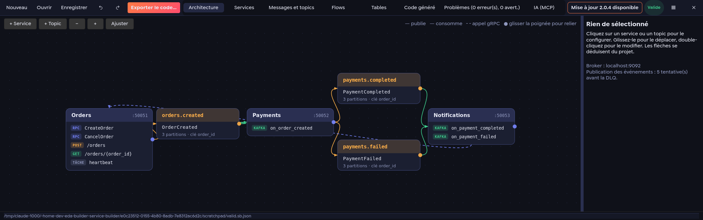
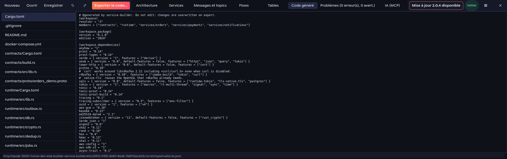
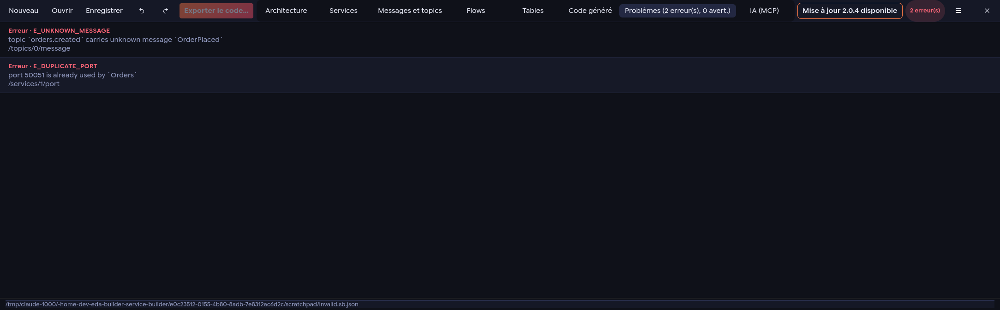

# Service Builder

Un éditeur visuel, « à la Elementor », pour construire des **backends Rust événementiels** :
vous dessinez des services, des topics Kafka, des schémas protobuf et la logique de chaque
handler avec des blocs ; l'application génère un workspace Cargo complet
(**gRPC** avec tonic pour les RPC, **Kafka** avec rdkafka pour les événements).

Application de bureau Linux : **egui** (eframe, rendu GPU par wgpu).



## Le principe

| Elementor | Service Builder |
| --- | --- |
| Page | Projet (un fichier `*.sb.json`) |
| Widgets | Étapes : *Publier un événement*, *Appeler un RPC*, *Condition*, *Variable*, *Journal*, *Répondre*, *Code Rust* |
| Canvas | Graphe d'architecture : services ⇄ topics ⇄ services, dérivé du modèle |
| Panneau de réglages | Inspecteur : RPC, consumers, mappings champ à champ typés |
| Aperçu en direct | Onglet « Code généré » : Rust, `.proto`, `Cargo.toml`, `docker-compose.yml` |
| Publier | « Exporter le code » : un workspace Cargo prêt à `cargo run` |
| Hébergement | Onglet « Projets » : les projets gardés dans S3 (Garage), une version par enregistrement ; onglet « Infra » : les fichiers `docker-compose` et de configuration qui lancent les services |



Ce qui est vérifié en continu pendant que vous éditez (et qui bloque l'export s'il y a une erreur) :

- les références (topic, message, service, RPC), les noms et l'unicité des ports ;
- le **typage des mappings** : `input.customer.name` (string) ne peut pas remplir un `int64` ;
- la portée des variables (une variable définie dans une branche n'existe pas après elle) ;
- la syntaxe du Rust brut tapé dans les blocs *Code Rust* ou *Rust* ;
- des avertissements de topologie (topic que personne ne publie ou ne consomme, RPC sans réponse…).



## Démarrer

Prérequis : Rust stable (aucune bibliothèque système à installer pour compiler ; à l'exécution, un pilote Vulkan, Metal
ou OpenGL, et la police Inter si possible, sinon la police système la plus proche).
Node 22 n'est utile que pour les scripts de release (`scripts/`).

```sh
cargo run -p service-builder     # lance l'application
SB_SHOTS=/tmp/captures cargo test -p service-builder --test screens -- --ignored   # une capture PNG par page, sans écran
```

Un projet d'exemple (Orders → Payments → Notifications) est chargé au démarrage.

## Le code généré

« Exporter le code » écrit un workspace Cargo autonome :

```
contracts/      messages + stubs gRPC (générés depuis le .proto, sans protoc grâce à protox) et noms de topics
runtime/        producer / consumer Kafka, création des topics, DLQ (identique pour tous les projets)
services/<nom>/ un binaire par service : main.rs (démarrage), app/ (config, contexte), transport/ (gRPC, HTTP, Kafka), flows/ (la logique dessinée)
docker-compose.yml   un Kafka local (KRaft) sur localhost:9092 et un PostgreSQL sur localhost:5432 (une base par service)
```

```sh
cd mon-export
docker compose up -d
cargo run -p orders        # un terminal par service
```

Pour compiler : un toolchain C/C++, `cmake`, `pkg-config` et les en-têtes OpenSSL
(`sudo apt install build-essential cmake pkg-config libssl-dev`).

Garanties de livraison : les consumers sont **at-least-once** (l'offset est validé après le handler). Un
message qui échoue 3 fois, ou qui n'est pas décodable, est écrit sur `<topic>.dlq`. Écrivez des handlers idempotents.

## Installer, versions

**Sur votre machine.** La CI ne construit plus l'application : `scripts/install-local.sh` compile en release, fabrique
l'AppImage (avec le binaire Garage, `scripts/fetch-garage.sh`) et remplace `~/Applications/Service.Builder.AppImage` (`SB_APPLICATIONS=<dossier>` pour la poser ailleurs).
Relancez l'application pour utiliser la nouvelle version. Il n'y a plus de mise à jour automatique dans l'application.

**Dans la CI** (`.github/workflows/ci.yml`). Elle ne fait que **tester** : formatage, clippy, tests, et compilation du code
généré. Rien n'est construit ni publié, et la version (`Cargo.toml`, `Cargo.lock`) ne change plus toute seule :
`node scripts/release.mjs bump <minor|normal|major>` l'incrémente à la main si besoin.

### Où tourne la CI

Les contrôles (formatage, clippy, tests, code généré) tournent sur un **runner auto-hébergé** (libellé
`service-builder`) : plus rapide, et sans minutes GitHub.  Une PR
venue d'un **fork** ne touche jamais le runner local : elle retombe sur un runner GitHub. Chaque commit d'une PR n'est
testé qu'une fois (pas de double exécution push + PR), et seul `main` est testé à chaque push.

Installer le runner sur une machine : télécharger le runner officiel, puis
`./config.sh --url https://github.com/<org>/service-builder --token <jeton> --labels service-builder` et `./run.sh`
(le jeton vient de `gh api -X POST repos/<org>/service-builder/actions/runners/registration-token`). La machine
doit avoir Rust stable (rustfmt, clippy), Node 22, et cmake ; son
fichier `.env` doit contenir le `PATH` qui les trouve. Pour qu'il survive à la session, un service `systemd --user`
suffit (`ExecStart=<dossier du runner>/run.sh`, `systemctl --user enable --now …`). Hors ligne, les jobs attendent :
désenregistrer le runner et remettre `ubuntu-24.04` dans `runs-on` suffit pour revenir aux runners GitHub.

## Piloter le projet depuis une IA (MCP)

L'onglet **MCP** active un serveur [MCP](https://modelcontextprotocol.io) sur stdio : un client comme Claude Code lance
`service-builder mcp [projet.sb.json]` (ou `sb mcp [projet.sb.json]`) et peut chercher, charger, lire, modifier, valider, versionner et exporter
les projets. Sans fichier, le serveur travaille sur le dernier projet ouvert dans l'application, ou attend que l'agent en charge un. Le bouton **Activer** ajoute l'entrée `service-builder-<projet>` au `.mcp.json` du dossier du projet, sans
toucher aux autres entrées ; l'onglet affiche aussi la commande, la ligne `claude mcp add` et la configuration JSON des
autres clients. Outils : `describe_project`, `get_project`, `get_example_project`, `patch_project` (RFC 6902, tout ou
rien), `set_project`, `validate`, `list_generated_files`, `read_generated_file`, `export_code`, et pour les projets du
stockage : `search_projects` (cherche dans S3 et sur la machine), `load_project` (un agent charge un projet de lui-même, par
id ou par nom, éventuellement une ancienne `version`), `list_versions` et `save_version`.

**Suggestions des agents.** Tous les 50 appels d'outil, le serveur demande à l'agent, dans le résultat même de l'appel,
un rapport sur ce qui lui a manqué (par exemple un bloc de logique qui exécute un traitement bloquant comme le hachage
d'un mot de passe dans `spawn_blocking`) ; l'agent le dépose avec l'outil `submit_report` (il peut aussi le faire de
lui-même). Les rapports restent à côté du projet, dans `.service-builder/<projet>.mcp.json` (à ignorer dans git si
besoin), et s'affichent dans l'onglet MCP. **Rien n'est envoyé tout seul** : « Envoyer sur GitHub » ouvre dans votre
navigateur une issue pré-remplie (étiquette `agent-suggestion`, dépôt `entcorporg/service-builder`) que vous relisez
avant de la publier, et « Ignorer » la supprime. La demande se désactive d'une case à cocher.

Le serveur ne garde aucun état : il lit et écrit le fichier du projet, qui doit donc être enregistré. L'application le
recharge quand sa fenêtre reprend le focus, sauf s'il y a des modifications non enregistrées (elle prévient alors que
l'enregistrement écrasera celles du client). Le projet n'est pas protégé contre deux éditeurs simultanés : le dernier
qui enregistre l'emporte.

## Où sont gardés les projets (onglet Projets)

Les projets sont gardés dans un stockage S3 **interne** : un Garage livré dans l'AppImage, que l'application démarre et
prépare toute seule (nœud sur `127.0.0.1:39000`, bucket, clé tirée au hasard, le tout dans
`~/.local/share/service-builder/garage/`). Rien à installer, rien à régler, et aucun champ pour y toucher : l'onglet
**Projets** dit seulement s'il est prêt. Il continue de tourner quand la fenêtre se ferme, pour que le serveur MCP et `sb`
le trouvent.

- **Chaque enregistrement (Ctrl+S) est une version** : un fichier inchangé n'en fait pas, l'historique n'est jamais
  réécrit. L'onglet liste les versions du projet ouvert ; *Restaurer* en remet une dans l'éditeur, et l'enregistrer en fait
  une nouvelle.
- **Le dernier projet ouvert se rouvre tout seul** au lancement ; l'onglet liste aussi les derniers projets ouverts et
  ceux du bucket. Si le stockage ne répond pas, tout reste en local : les projets sont des fichiers dans
  `~/.local/share/service-builder/projects/` et la barre d'outils signale « S3 · à enregistrer » ou « S3 · échec ».
- **Exporter le code** écrit aussi le JSON du projet (`<nom>.sb.json`) à côté du code.
- Un agent qui modifie le fichier (MCP) voit ses changements envoyés une fois qu'il a fini d'écrire.

## Les fichiers qui lancent les services (onglet Infra)

Service Builder ne démarre rien lui-même. L'onglet **Infra** règle l'infrastructure, dans un formulaire enregistré dans
le projet, et le bouton **Exporter l'infra** (aussi dans le menu ⋮ de la barre d'outils) écrit tout ce qu'il faut pour la lancer :

- `docker-compose.yml` : Kafka, PostgreSQL, et Mailpit ou DragonflyDB selon les services (le même que celui de l'export du code) ;
- `docker-compose.override.yml`, que `docker compose` fusionne par-dessus : limites de ressources, Adminer, Kafka UI,
  Garage, Traefik et les services eux-mêmes ;
- `traefik/` (`traefik.yml`, `dynamic/*.yaml`), `garage/` (`garage.toml`, `init.sh`), `Dockerfile`, `build.sh`.

Les réglages : les **ressources** (CPU, redémarrage, mémoire d'un service, de Kafka et de PostgreSQL), les **interfaces**
(Adminer, Kafka UI), le **stockage objet** (si un service a une étape objet, **Garage** rejoint la stack avec ses buckets
et la clé d'accès des services), et **Traefik** (domaine et Let's Encrypt, ou HTTP sur `*.localhost`, un hôte par
interface, les frontends, CORS, limite de débit).

Exportez dans le dossier du code exporté (l'image se construit depuis lui) ; l'en-tête de `docker-compose.override.yml`
donne les commandes : construire les images, compiler les services dans le conteneur de build, puis `docker compose up -d`.
Détails dans [docs/ARCHITECTURE.md](docs/ARCHITECTURE.md#infra--les-fichiers-qui-lancent-les-services).

## En ligne de commande

Le binaire `sb` utilise exactement le même code que l'application (pratique en CI) :

```sh
cargo run -p sb-app --bin sb -- sample > projet.sb.json   # projet d'exemple
cargo run -p sb-app --bin sb -- validate projet.sb.json   # code de sortie 1 s'il y a des erreurs
cargo run -p sb-app --bin sb -- generate projet.sb.json ./out
cargo run -p sb-app --bin sb -- infra projet.sb.json ./out # docker-compose.yml, l'override, Traefik, Garage, Dockerfile
cargo run -p sb-app --bin sb -- projects [texte]          # les projets de S3 et de cette machine
cargo run -p sb-app --bin sb -- pull <id> [version]       # met un projet de S3 dans sa copie de travail
cargo run -p sb-app --bin sb -- push projet.sb.json       # en enregistre une version dans S3
cargo run -p sb-app --bin sb -- mcp [projet.sb.json]      # serveur MCP sur stdio
```

## Tests

```sh
cargo test --workspace                 # modèle, validation, générateur, logique applicative (formulaires d'étapes, renommages, portée des variables, client S3, versions)
node --test scripts/release.test.mjs   # détection du type de mise à jour et incrément de version
```

Le test le plus important n'est pas dans cette liste : le workspace **généré** doit compiler
(`cargo run -p sb-codegen --example dump -- /tmp/gen && cd /tmp/gen && cargo check --workspace`).
La CI le fait.

## Limites actuelles

À savoir avant de s'en servir sérieusement :

- **Le code généré n'a pas été exécuté de bout en bout** : il compile (sans warning). Le relais de l'outbox
  (réveil `NOTIFY`, reprises, ordre par clé, DLQ) a été éprouvé contre un vrai PostgreSQL et un vrai broker, mais
  pas les consumers ni les appels gRPC entre services démarrés ensemble.
- Les flèches du canvas sont **dérivées** du modèle. On ne peut tracer à la souris que *topic → service* (cela crée
  un consumer) et *service → topic* (cela déclare le producteur) ; publier et appeler un RPC se configurent dans les
  étapes de l'inspecteur.
- La logique d'un flux se fait sans Rust (conditions `et` / `ou` / `non`, présence, boucle `forEach`, texte avec
  valeurs, arithmétique, `default`, `newUuid`), mais il reste des manques : pas de **variable modifiable** (une boucle
  ne peut donc ni cumuler un total ni compter), pas de somme ni de filtre sur une liste, pas de **dates** (maintenant
  ± une durée, comparaison d'expiration : seule l'horloge de la base, dans un bloc SQL), pas de `break` ni d'appel de
  sous-flux, pas d'accès à l'élément *n* d'une liste, pas d'expressions régulières, et une `Variable` de type schéma
  reste en Rust. Un nombre n'est jamais converti en silence : `toInt64`, `toDouble`… s'écrivent.
- Le bloc SQL n'a pas encore d'agrégats (`COUNT` par groupe, `SUM`, `GROUP BY`), de jointure d'une table à elle-même (alias) ni de `OR` entre
  conditions ; le total d'une page est le seul `COUNT`. Renommer une colonne jointe change le nom du champ de la ligne
  (`<table>_<colonne>`) : le schéma rempli et les lectures du flux suivent, pas le code Rust d'une étape *Code Rust*.
- La spécification OpenAPI ne décrit pas les statuts qu'un bloc *Code Rust* choisirait lui-même, ni l'authentification
  comme schéma de sécurité (un jeton lu d'un en-tête y est un paramètre).
- Les appels HTTP sortants (*Appeler une API HTTP*) tournent dans la transaction du flux : un délai (30 s au plus, 60 s avec
  les réessais) y garde une connexion et les verrous déjà pris ; pas de file d'appels après le commit. Le corps JSON est plat
  (pas d'objet imbriqué) et la réponse est lue en JSON seulement.
- L'aperçu de l'éditeur de mails est dessiné par l'interface, pas par un client de messagerie : il ne charge pas les
  images et ne dit pas ce que Gmail ou Outlook feront du HTML (le bouton « Ouvrir dans le navigateur » s'en approche).
- Les tables se conçoivent dans la vue **Tables** et se lisent avec le bloc SQL. Les migrations renomment et suppriment
  (colonnes, tables), convertissent le type et changent le caractère nul d'une colonne, d'après un historique gardé dans
  le projet ; ce qui est retiré de l'historique avant que toutes les bases l'aient reçu n'est plus rejoué.
- L'export **écrase** les fichiers générés : la logique sur mesure passe par l'étape *Code Rust*, pas par l'édition
  des fichiers exportés.
- Renommer un champ met à jour les mappings qui le ciblent, mais pas les expressions qui le *lisent*
  (`input.ancien_nom`) : la validation les signale.
- Les événements sont du protobuf brut, sans schema registry.
- L'interface est en français uniquement.
- L'interface (egui) édite tout le projet : architecture (canvas, flèches à tracer depuis la poignée de sortie d'un
  nœud), services (standard, mail, temps réel), messages et leurs champs (règles et sources des schémas d'API), topics,
  flows (RPC, routes, consommateurs, jobs, avec étapes et branches) et tables SQL (colonnes, uniques, index, clés
  étrangères). Annuler/rétablir (Ctrl+Z / Ctrl+Maj+Z), enregistrer (Ctrl+S), ouvrir (Ctrl+O). Les formulaires
  d'étapes sont générés depuis le JSON Schema du modèle (`sb_app::stepform`) : chaque champ est un texte, les
  expressions s'écrivent `a.b`, `"texte"`, `42`, `now` ou `rust: code`, et les variables disponibles sont listées.
  Renommer un service, un message, un topic, un RPC ou une table met à jour toutes ses références
  (`sb_app::rename`) ; les noms de colonnes et de contraintes ne se changent pas après création.
- Les dialogues, le glisser à la souris, l'AppImage n'a pas été exercé de bout en
  bout (seule la logique pure est testée : `stepform.rs`, `rename.rs`, `scope.rs`, le graphe et
  l'adressage des étapes). `SB_SCREENSHOT=<dossier>` permet de vérifier le rendu de chaque onglet.

La conception et la feuille de route sont dans [docs/ARCHITECTURE.md](docs/ARCHITECTURE.md).
