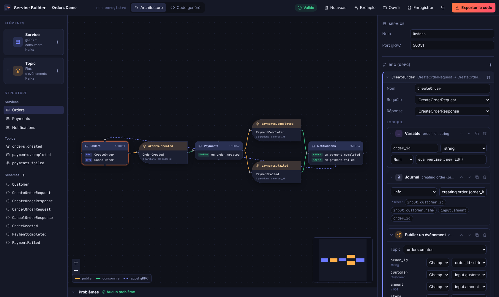
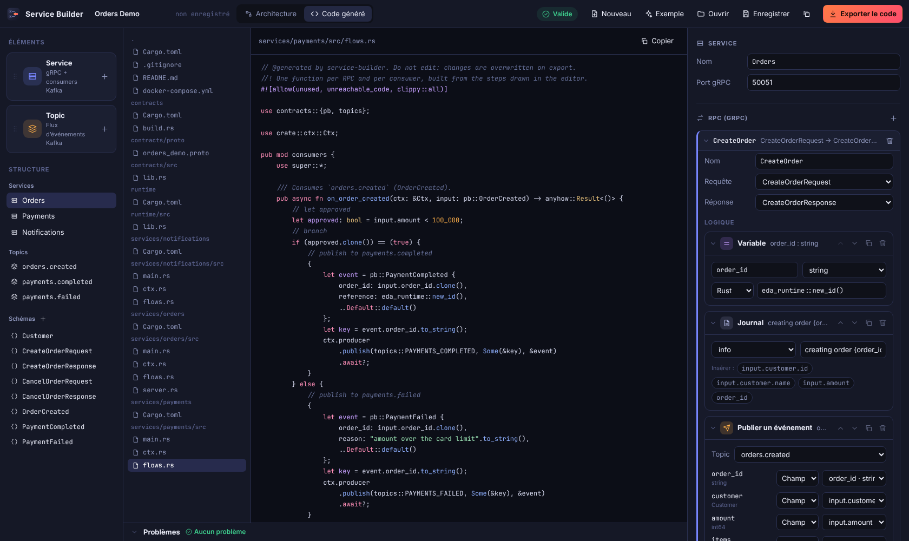
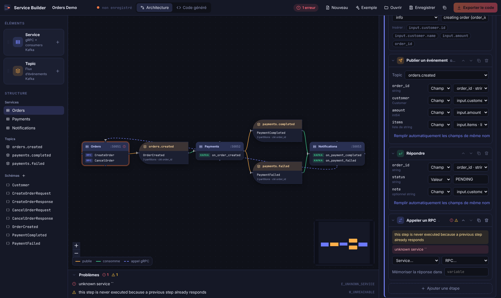

# Service Builder

Un éditeur visuel, « à la Elementor », pour construire des **backends Rust événementiels** :
vous dessinez des services, des topics Kafka, des schémas protobuf et la logique de chaque
handler avec des blocs ; l'application génère un workspace Cargo complet
(**gRPC** avec tonic pour les RPC, **Kafka** avec rdkafka pour les événements).

Application de bureau Linux : **Tauri 2** (Rust) + **React** (xyflow pour le canvas).



## Le principe

| Elementor | Service Builder |
| --- | --- |
| Page | Projet (un fichier `*.sb.json`) |
| Widgets | Étapes : *Publier un événement*, *Appeler un RPC*, *Condition*, *Variable*, *Journal*, *Répondre*, *Code Rust* |
| Canvas | Graphe d'architecture : services ⇄ topics ⇄ services, dérivé du modèle |
| Panneau de réglages | Inspecteur : RPC, consumers, mappings champ à champ typés |
| Aperçu en direct | Onglet « Code généré » : Rust, `.proto`, `Cargo.toml`, `docker-compose.yml` |
| Publier | « Exporter le code » : un workspace Cargo prêt à `cargo run` |



Ce qui est vérifié en continu pendant que vous éditez (et qui bloque l'export s'il y a une erreur) :

- les références (topic, message, service, RPC), les noms et l'unicité des ports ;
- le **typage des mappings** : `input.customer.name` (string) ne peut pas remplir un `int64` ;
- la portée des variables (une variable définie dans une branche n'existe pas après elle) ;
- la syntaxe du Rust brut tapé dans les blocs *Code Rust* ou *Rust* ;
- des avertissements de topologie (topic que personne ne publie ou ne consomme, RPC sans réponse…).



## Démarrer

Prérequis : Rust stable, Node 22, pnpm 10. Sous Ubuntu/Debian, les bibliothèques de Tauri :

```sh
sudo apt install libwebkit2gtk-4.1-dev libgtk-3-dev libsoup-3.0-dev libayatana-appindicator3-dev \
  librsvg2-dev libssl-dev pkg-config build-essential
```

```sh
pnpm install
pnpm tauri dev      # lance l'application avec rechargement à chaud
```

Un projet d'exemple (Orders → Payments → Notifications) est chargé au démarrage.

## Le code généré

« Exporter le code » écrit un workspace Cargo autonome :

```
contracts/      messages + stubs gRPC (générés depuis le .proto, sans protoc grâce à protox) et noms de topics
runtime/        producer / consumer Kafka, création des topics, DLQ (identique pour tous les projets)
services/<nom>/ un binaire par service : main.rs (démarrage), app/ (config, contexte), transport/ (gRPC, HTTP, Kafka), flows/ (la logique dessinée)
docker-compose.yml   un Kafka local (KRaft) sur localhost:9092 et un PostgreSQL sur localhost:5432 (une base par service)
```

```sh
cd mon-export
docker compose up -d
cargo run -p orders        # un terminal par service
```

Pour compiler : un toolchain C/C++, `cmake`, `pkg-config` et les en-têtes OpenSSL
(`sudo apt install build-essential cmake pkg-config libssl-dev`).

Garanties de livraison : les consumers sont **at-least-once** (l'offset est validé après le handler). Un
message qui échoue 3 fois, ou qui n'est pas décodable, est écrit sur `<topic>.dlq`. Écrivez des handlers idempotents.

## Mises à jour et versions

**Dans l'application.** Au lancement, Service Builder interroge les releases GitHub
(`releases/latest/download/latest.json`). Si une version plus récente existe, le bouton **Mettre à jour**, à côté de
*Exporter le code*, affiche son numéro ; un clic télécharge le paquet, vérifie sa signature, l'installe et relance
l'application (une confirmation prévient si le projet a des modifications non enregistrées). Sans nouvelle version,
le bouton lance une recherche à la demande. Une recherche impossible (hors ligne, aucune release) est silencieuse au
lancement et signalée quand on clique. Sous Linux, seul l'AppImage se met à jour seul ; le `.deb` se réinstalle.

**Dans la CI** (`.github/workflows/ci.yml`). Deux règles :

1. **Chaque changement annonce son type de mise à jour**, par une mention dans le titre ou la description de la PR,
   ou dans un message de commit : `[minor]` (0.0.**X**), `[normal]` (0.**X**.0) ou `[major]` (**X**.0.0). Une PR sans
   mention échoue ; si plusieurs mentions coexistent, la plus forte l'emporte.
2. **Un push sur `main` avec mention incrémente la version**, une fois tous les tests passés : `0.1.0` + `[normal]`
   donne `0.2.0` (les nombres à droite repartent à zéro). La CI écrit la nouvelle version dans `Cargo.toml`,
   `Cargo.lock`, `tauri.conf.json` et les deux `package.json`, commite `chore(release): vX.Y.Z [skip ci]`, pose le
   tag `vX.Y.Z`, puis construit les paquets signés et publie la release GitHub avec le `latest.json` que lit l'application.
   Sans mention, rien n'est publié.

Réglage unique, à faire une fois : ajouter la clé privée de signature aux secrets du dépôt
(`gh secret set TAURI_SIGNING_PRIVATE_KEY < ~/.tauri/service-builder.key`). La clé publique correspondante est dans
`src-tauri/tauri.conf.json` ; sans la clé privée, les mises à jour ne peuvent pas être signées. Si `main` est protégée,
autorisez `github-actions[bot]` à y pousser le commit de version.

## Piloter le projet depuis une IA (MCP)

L'onglet **MCP** active un serveur [MCP](https://modelcontextprotocol.io) sur stdio : un client comme Claude Code lance
`service-builder mcp <projet.sb.json>` (ou `sb mcp <projet.sb.json>`) et peut lire, modifier, valider et exporter le
projet. Le bouton **Activer** ajoute l'entrée `service-builder-<projet>` au `.mcp.json` du dossier du projet, sans
toucher aux autres entrées ; l'onglet affiche aussi la commande, la ligne `claude mcp add` et la configuration JSON des
autres clients. Outils : `describe_project`, `get_project`, `get_example_project`, `patch_project` (RFC 6902, tout ou
rien), `set_project`, `validate`, `list_generated_files`, `read_generated_file`, `export_code`.

Le serveur ne garde aucun état : il lit et écrit le fichier du projet, qui doit donc être enregistré. L'application le
recharge quand sa fenêtre reprend le focus, sauf s'il y a des modifications non enregistrées (elle prévient alors que
l'enregistrement écrasera celles du client). Le projet n'est pas protégé contre deux éditeurs simultanés : le dernier
qui enregistre l'emporte.

## En ligne de commande

Le binaire `sb` utilise exactement le même code que l'application (pratique en CI) :

```sh
cargo run -p sb-app --bin sb -- sample > projet.sb.json   # projet d'exemple
cargo run -p sb-app --bin sb -- validate projet.sb.json   # code de sortie 1 s'il y a des erreurs
cargo run -p sb-app --bin sb -- generate projet.sb.json ./out
cargo run -p sb-app --bin sb -- mcp projet.sb.json        # serveur MCP sur stdio
```

## Tests

```sh
cargo test --workspace                 # modèle, validation, générateur, logique applicative
pnpm --dir ui test                     # logique TypeScript (typage, renommages en cascade)
cargo build -p sb-app --bin sb && pnpm --dir ui e2e   # scénarios Playwright, avec le vrai code Rust
node --test scripts/release.test.mjs   # détection du type de mise à jour et incrément de version
```

Le test le plus important n'est pas dans cette liste : le workspace **généré** doit compiler
(`cargo run -p sb-codegen --example dump -- /tmp/gen && cd /tmp/gen && cargo check --workspace`).
La CI le fait.

## Limites actuelles

À savoir avant de s'en servir sérieusement :

- **Le code généré n'a pas été exécuté de bout en bout** : il compile (sans warning). Le relais de l'outbox
  (réveil `NOTIFY`, reprises, ordre par clé, DLQ) a été éprouvé contre un vrai PostgreSQL et un vrai broker, mais
  pas les consumers ni les appels gRPC entre services démarrés ensemble.
- Les flèches du canvas sont **dérivées** du modèle. On ne peut tracer à la souris que *topic → service* (cela crée
  un consumer) et *service → topic* (cela déclare le producteur) ; publier et appeler un RPC se configurent dans les
  étapes de l'inspecteur.
- Le bloc SQL lit une seule table à la fois (pas de jointure, pas de clé étrangère dans la conception des tables) ; l'API HTTP n'a ni authentification, ni spécification OpenAPI générée, ni validation des champs obligatoires.
- Les tables se conçoivent dans la vue **Tables** et se lisent avec le bloc SQL ; les migrations sont additives (pas de
  renommage ni de suppression de colonne). Pas d'inbox (déduplication côté consumer).
- Pas d'annuler/rétablir. L'export **écrase** les fichiers générés : la logique sur mesure passe par
  l'étape *Code Rust*, pas par l'édition des fichiers exportés.
- Renommer un champ met à jour les mappings qui le ciblent, mais pas les expressions qui le *lisent*
  (`input.ancien_nom`) : la validation les signale.
- Les événements sont du protobuf brut, sans schema registry.
- L'interface est en français uniquement.
- Les dialogues de fichiers natifs (GTK) n'ont pas été exercés automatiquement (les tests simulent les dialogues) ;
  `pnpm tauri build` (paquets `.deb` / AppImage) n'a pas été essayé. L'application en mode `tauri dev`
  a été lancée et pilotée dans un serveur X virtuel.

La conception et la feuille de route sont dans [docs/ARCHITECTURE.md](docs/ARCHITECTURE.md).
