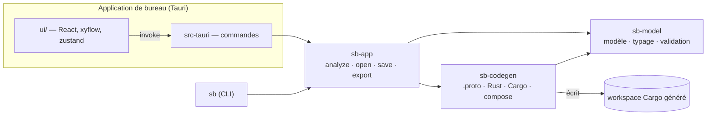
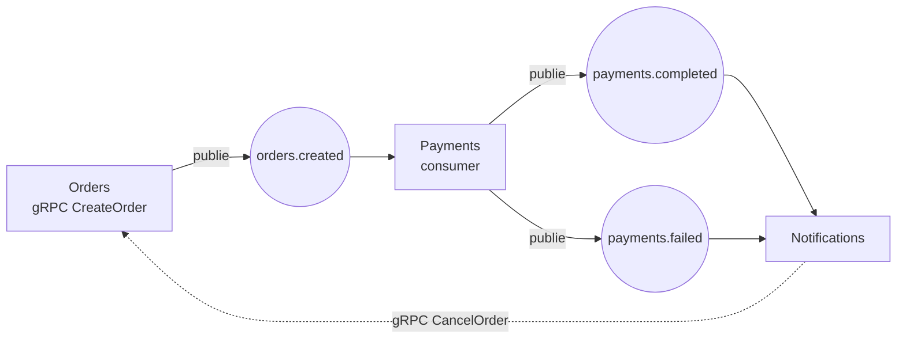
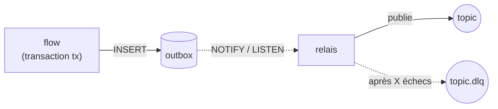

# Architecture

## Vue d'ensemble



| Crate / dossier | Rôle |
| --- | --- |
| `crates/sb-model` | Le document : `Project`, `Service`, `Topic`, `Message`, `Step`… (JSON camelCase), règles de nommage, typage léger des mappings, validation avec diagnostics. Aucune dépendance à Tauri ni au générateur. |
| `crates/sb-codegen` | Du modèle vers un workspace Cargo : `.proto`, crate `contracts`, crate `runtime` embarquée, un crate par service, `docker-compose.yml`. Pur et déterministe. |
| `crates/sb-app` | Services applicatifs partagés par l'app et le CLI `sb` : `analyze` (validation + génération + rustfmt), ouvrir/sauver, exporter. |
| `src-tauri` | Fine couche de commandes Tauri au-dessus de `sb-app`. |
| `ui/` | L'éditeur. Tout ce qui est « intelligent » (validation, génération) est appelé côté Rust. |

## Le modèle de projet

Un projet est un fichier JSON (`schemaVersion`, `messages`, `topics`, `services`). Les projets enregistrés par une version
plus ancienne sont migrés à l'ouverture (producteurs déclarés, types de schémas déduits : la charge utile d'un topic
devient un `event`, le reste un `proto`). C'est la seule source de
vérité : le canvas, l'inspecteur et le code généré en sont des vues.

- **Schémas** : un schéma est un ensemble de champs nommé, avec un **type** qui dit à quoi il sert :
  - `event` : la charge utile d'un topic Kafka ;
  - `proto` : une requête ou réponse gRPC, et les types partagés (un `Customer` imbriqué dans un événement et
    dans une requête, par exemple) ;
  - `api` : le corps, les paramètres et la réponse d'une route HTTP (voir [API HTTP](#api-http)) ; ils sont aussi lus et
    écrits en JSON.

  Les règles sont vérifiées : un topic ne transporte qu'un `event` (`E_TOPIC_MESSAGE_KIND`), un RPC n'utilise que
  des `proto` (`E_RPC_MESSAGE_KIND`), et les `api` ne se mélangent pas aux deux autres, ni en imbrication
  (`E_SCHEMA_KIND_MIX`). Les `event` et `proto` peuvent s'imbriquer (ils sont tous deux en protobuf), ce qui
  permet de copier un champ d'une requête vers un événement sans conversion. Tous les schémas sont des messages
  protobuf ; chaque champ a un **numéro stable** (`tag`) : une fois des événements écrits dans Kafka,
  renuméroter casserait les consumers. L'éditeur attribue un numéro à la création et ne le réutilise pas tant que le
  champ existe ; le générateur numérote les champs sans `tag` dans l'ordre.
- **Topics** : un topic transporte exactement un type de message ; un champ clé optionnel donne la clé de partition
  (l'ordre est garanti par clé).
  Un topic déclare ses **producteurs** : les services propriétaires de l'événement. Une étape *Publier* dans un
  autre service est une erreur (`E_NOT_PRODUCER`). On les déclare en tirant une flèche service → topic, dans la
  section « Producteurs » du topic, ou implicitement en ajoutant une étape *Publier* (le service est alors déclaré).
  Un producteur sans étape *Publier* donne un avertissement. Les projets enregistrés avant (`schemaVersion` 1) sont
  migrés à l'ouverture : tout service qui publiait sur un topic en devient producteur.
- **Services** : des RPC (gRPC) et des consumers (Kafka). Chacun contient une **liste d'étapes**.
- **Étapes** : `log`, `let`, `publish`, `callRpc`, `branch` (étapes imbriquées), `respond`, `code`.
  Une liste d'étapes est un arbre (pas un graphe arbitraire) : cela se génère en Rust structuré et s'édite comme
  une pile de blocs, comme dans un page builder.

### Noms

Les noms saisis deviennent des identifiants Rust, protobuf et Kafka. On n'accepte que les noms dont la
conversion est sans perte (`order_id` reste `order_id`, `HTTPServer` est refusé car prost le transformerait en
`HttpServer`). Ainsi `input.order_id` dans l'éditeur est exactement `input.order_id` dans le Rust généré.

### Expressions et typage

Une valeur est un **champ** (`input.customer.name`), un **littéral**, ou du **Rust brut**. Les deux premiers sont
typés (`sb-model/src/typing.rs`) : un chemin se résout champ par champ, et il peut remplir un champ cible s'il a le
même type, ou s'il s'élargit en `optional`. Les messages étant des `Option<Msg>` en prost, lire à travers un message
absent donne la valeur par défaut (`.as_ref().map(..).unwrap_or_default()`).

Le Rust brut n'est pas typé : c'est l'échappatoire. Sa syntaxe est tout de même vérifiée avec `syn`, avec le chemin
exact de l'étape fautive.

`ui/src/scope.ts` reprend ces règles pour **proposer** les champs compatibles ; le validateur Rust reste l'autorité
et un test (`scope.test.ts`) fixe la parité sur les cas importants.

### Diagnostics

Chaque diagnostic porte un `code` stable (`E_UNKNOWN_TOPIC`…), un message et un **JSON pointer** vers l'élément
(`/services/0/rpcs/1/steps/2/then/0`). L'UI s'en sert pour afficher le badge sur le bon nœud ou la bonne étape.

## Le code généré



- **Contrats** : un seul `.proto` (package = nom du projet). `protox` le compile en Rust pur, donc **pas de `protoc`**
  à installer. Les noms de topics deviennent des constantes (`topics::ORDERS_CREATED`).
- **Runtime** (`crates/sb-codegen/templates/runtime`) : écrit tel quel dans chaque export. Il contient tout ce qui
  n'a pas à varier : producer idempotent, création des topics au démarrage (avec attente du broker),
  `consume()` at-least-once avec 3 essais puis DLQ, et l'[outbox](#persistance-et-outbox).
- **Un service = un binaire**, organisé par responsabilité :

  ```
  services/payments/src/
  ├── main.rs              la séquence de démarrage, rien d'autre
  ├── app/                 config.rs (env), ctx.rs (base de données + clients gRPC), bootstrap.rs (topics, base, attente)
  ├── transport/           comment l'extérieur atteint le service
  │   ├── grpc.rs          le serveur tonic : traduit et délègue à flows::rpc
  │   ├── http.rs          les routes pour le front (axum) : traduit le JSON et délègue à flows::api
  │   ├── kafka.rs         les abonnements : topic, groupe, type de message → flows::consumers
  │   └── outbox.rs        le relais qui publie les événements mis en file par les flows
  └── flows/               la logique dessinée : rpc.rs, api.rs, consumers.rs (une fonction par RPC, route ou consumer)
  ```

  Un transport ne contient aucune logique métier et les flows ne connaissent ni tonic ni rdkafka : ajouter un
  transport (WebSocket, par exemple) ne touche pas aux flows. Les fichiers inutiles ne sont pas générés (pas de
  `grpc.rs` sans RPC, pas de `http.rs` sans route, pas de `kafka.rs` sans consumer, pas de `outbox.rs` si le service ne publie rien).
- Les adresses se règlent par variables d'environnement : `KAFKA_BROKERS`, `<SERVICE>_PORT`, `<SERVICE>_HTTP_PORT`,
  `<SERVICE>_URL`, `<SERVICE>_DATABASE_URL`, `OUTBOX_MAX_ATTEMPTS`, `CORS_ORIGINS`.

### API HTTP

Un service peut aussi recevoir des requêtes **HTTP du front** : ce sont ses **routes** (section « API HTTP » de
l'inspecteur), à côté des RPC et des consumers. Une route a une méthode (`GET`, `POST`, `PUT`, `PATCH`, `DELETE`), un
chemin, un schéma `api` de requête, un schéma `api` de réponse, un statut de succès (200, 201 ou 202) et une liste
d'étapes, exactement comme un RPC (y compris *Publier* : l'événement passe par l'outbox).

- **De la requête au schéma** : `input` est le schéma de requête. Les `{param}` du chemin remplissent le champ du même
  nom (chaîne, booléen, int32 ou int64, obligatoire) ; les autres champs viennent du **corps JSON** (`POST`, `PUT`,
  `PATCH`) ou de la **query string** (`GET`, `DELETE`, champs simples uniquement).
- **JSON** : les noms de champs sont ceux du schéma, sans conversion (`order_id` reste `order_id`). Un champ absent de
  la requête prend sa valeur par défaut. `bytes` et `timestamp` n'ont pas encore de forme JSON dans les schémas API.
- **Erreurs** : `{ "error": "..." }`. Un flow choisit le statut avec
  `return Err(eda_runtime::http::HttpError::not_found("...").into())` dans une étape *Code Rust* (la transaction est
  alors annulée) ; toute autre erreur donne un 500 dont le détail reste dans les journaux.
- **CORS** : les origines autorisées se règlent avec `CORS_ORIGINS` (`*` par défaut, à restreindre en production).
- **Ports** : chaque service a un port HTTP (`<SERVICE>_HTTP_PORT`), distinct des autres ports du projet. gRPC et HTTP
  tournent dans le même processus.
- **Validation** : chemin bien formé (`E_ROUTE_PATH`), pas deux routes de même méthode et même forme
  (`E_DUPLICATE_ROUTE`), paramètres présents dans la requête (`E_ROUTE_PARAM`), query string limitée aux champs
  simples (`E_ROUTE_QUERY_FIELD`), schémas de type `api` (`E_ROUTE_SCHEMA_KIND`).

**Le configurateur d'endpoint.** Cliquer une route (sur un service du canvas, dans l'arbre à gauche, ou en créer une)
remplace le canvas par un écran en deux colonnes : à gauche la **logique** (les étapes de la route), à droite le
**contrat JSON** : la requête (chaque champ dit d'où il vient : chemin, query ou corps) et la réponse, chacune avec
l'édition de son schéma et un exemple de JSON. La **réponse est produite par la logique** : sous le JSON, chaque champ lit
une valeur calculée par les étapes (l'étape « Répondre »). Pour une réponse qui demande plusieurs requêtes (plusieurs
tables, des listes), « Construire la réponse par la logique » ajoute une variable du type du schéma de réponse,
remplie en Rust avec `tx`, dont chaque champ alimente la réponse ; le bloc SQL le fait sans écrire de Rust. Une variable peut en effet porter un schéma entier,
construit en Rust (`E_LET_VALUE` si on essaie autre chose). « ← Architecture » ramène au canvas.

Pas encore : authentification, validation des champs obligatoires, pagination, spécification OpenAPI, jointures
entre tables dans le bloc SQL (une requête plus riche s'écrit en Rust avec `tx`).

### Tables et bloc SQL

Chaque service a sa base ; la vue **Tables** (onglet de la barre du haut) sert à concevoir ses tables : colonnes,
type (`string`, `bool`, `int32`, `int64`, `float`, `double`, `timestamp`, `uuid`), nullable, clé primaire, valeur par
défaut SQL. Le SQL de la table est affiché à côté. Au démarrage, le service applique le schéma de façon **additive** :
`CREATE TABLE IF NOT EXISTS` puis `ADD COLUMN IF NOT EXISTS` pour chaque colonne, donc une colonne ajoutée dans la
conception arrive dans une base existante (elle est nulle par défaut, pour ne pas échouer sur des lignes déjà là).
Renommer ou supprimer une colonne ne modifie pas les tables déjà créées.

Le bloc **SQL** est le huitième bloc de logique. Il lit une table du service dans la transaction du handler :

- **Lire** : on coche les colonnes. Le bloc est **prédictif** : la variable (`order`) est typée d'après les colonnes
  cochées, donc `order.status` est proposé dans les étapes suivantes (et refusé si la colonne n'est plus cochée,
  `E_UNKNOWN_PATH`). Une colonne nullable donne un champ optionnel ; `timestamp` et `uuid` se lisent en texte
  (ISO 8601 pour les dates). Une seule ligne (`404` si aucune ne correspond) ou **plusieurs** (liste, à convertir vers
  un schéma avec « Vers un schéma » : les colonnes de même nom remplissent ses champs, `E_SQL_INTO_FIELD` sinon),
  avec tri et limite. À la création du bloc, la condition est déjà posée : la clé primaire est rapprochée de la
  valeur de même nom dans la requête (`order_id = input.order_id`).
- **Insérer / Modifier / Supprimer** : les valeurs sont typées par leur colonne, une colonne obligatoire sans défaut
  doit recevoir une valeur (`E_SQL_MISSING_VALUE`), et une modification ou une suppression **sans condition** est
  refusée (`E_SQL_NO_WHERE`).

Les requêtes sont paramétrées (`$1`, `$2`…) : aucune valeur n'est collée dans le SQL. Techniquement, la ligne lue par un
bloc est un message dérivé (`OrdersRowH6`) que `Project::with_sql_rows` ajoute au projet avant la validation et la
génération ; il n'est jamais écrit dans un fichier projet ni dans le `.proto`.

### Persistance et outbox

Chaque service possède **sa propre base PostgreSQL** (`<SERVICE>_DATABASE_URL`, créée au démarrage si elle
n'existe pas). Un flow s'exécute dans **une transaction** (`tx`) : ce qu'il écrit et les événements qu'il publie
sont validés ensemble, ou pas du tout. Un flow ne parle donc jamais à Kafka : l'étape *Publier* écrit une ligne
dans la table `outbox`, et un **relais** la transmet au broker.



- **Réveil** : un trigger `AFTER INSERT` envoie `NOTIFY outbox`, le relais est en `LISTEN` : l'événement part dès le
  commit. Un minuteur couvre les reprises et les notifications perdues (reconnexion).
- **Reprises** : backoff exponentiel (1 s, 2 s, 4 s… jusqu'à 60 s). Après `maxAttempts` échecs (réglage du projet,
  surchargeable par `OUTBOX_MAX_ATTEMPTS`), l'événement est écrit sur `<topic>.dlq` avec les en-têtes `x-origin`,
  `x-attempts` et `x-error`, et la ligne reste dans la table avec `dead_at` renseigné. Si la DLQ est elle-même
  injoignable, la ligne reste en attente : rien n'est perdu en silence.
- **Ordre** : les événements d'une même clé restent dans l'ordre, un événement en attente de reprise retient les
  suivants de sa clé (jusqu'à ce qu'il parte en DLQ). Un seul relais travaille à la fois entre les réplicas
  (verrou consultatif).
- **Garanties** : at-least-once. Un crash entre l'accusé de Kafka et le commit republie la ligne ; les consumers
  doivent être idempotents. Les lignes publiées sont supprimées.
- **Étape Code Rust** : `tx` est disponible pour écrire ses propres données. Un `return` anticipé doit appeler
  `tx.commit().await?` avant, sinon tout est annulé (événements compris).

Ce qui n'est pas encore modélisé : les *données métier* elles-mêmes (entités, tables) et la déduplication côté
consumer (inbox). Pour l'instant elles s'écrivent à la main dans une étape *Code Rust*.

### Pourquoi générer plutôt qu'interpréter ?

Le résultat est du **Rust ordinaire** : lisible, versionnable, débogable, sans runtime propriétaire ni verrou
fournisseur. L'inconvénient assumé : le code exporté est un artefact. L'export écrase les fichiers, la logique
sur mesure vit dans les étapes *Code Rust* du projet.

### Les compromis qu'on a dû faire

- **`rdkafka` avec la feature `curl`.** librdkafka 2.12 inclut `<curl/curl.h>` même quand curl est désactivé
  (`#define WITH_OAUTHBEARER_OIDC 0` testé avec `#ifdef`). Sans cette feature, la compilation échoue sur toute machine
  sans `libcurl-dev`. Le workspace généré l'active (et le documente) ; à retirer quand l'amont sera corrigé.
- **Formatage.** Le générateur écrit lui-même un Rust commenté et valide (vérifié avec `syn`), puis `sb-app` passe
  `rustfmt` en parallèle si disponible. On n'utilise pas `prettyplease` : il supprime les commentaires.
- **DLQ.** Un message empoisonné est mis de côté, et si l'écriture sur la DLQ échoue elle est retentée sans fin
  (cela bloque la partition) : on ne perd jamais un message en silence.

## L'application

- **Canvas** : le graphe xyflow est *calculé* à partir du projet. Les positions sont stockées dans le projet (on
  sauve au lâcher du nœud) ; les tailles mesurées par xyflow sont conservées d'un calcul au suivant, sinon la minimap
  et le `fitView` les perdent.
- **État** : un store zustand + immer. Les composants éditent le projet avec `edit(draft => …)` ; les renommages
  (message, topic, service, RPC, champ) sont des fonctions de cascade dans `ui/src/model.ts`.
- **Boucle d'analyse** : après chaque modification (anti-rebond 250 ms), l'UI appelle `analyze(project)`. La réponse
  contient les diagnostics et, si le projet est valide, les fichiers générés. Les réponses arrivées dans le
  désordre sont ignorées. Quand le projet est invalide, la dernière version valide du code reste affichée,
  marquée comme périmée.
- **Glisser-déposer** : HTML5 natif depuis la palette. Vérifié dans WebKitGTK (la vraie fenêtre Tauri).

### Serveur MCP

`sb-app::mcp` implémente le protocole (JSON-RPC, un objet par ligne ; `initialize`, `ping`, `tools/list`,
`tools/call`) sans dépendance : le protocole utile tient en quelques méthodes. Il est exposé par `sb mcp <fichier>` et
par l'application elle-même (`service-builder mcp <fichier>`, traité dans `main.rs` avant d'ouvrir une fenêtre, ce qui
évite de livrer un second binaire). Les outils travaillent sur le *fichier* : chaque appel le relit, chaque édition le
réécrit. `patch_project` applique add / replace / remove (RFC 6902) sur le JSON, vérifie que le résultat est un projet,
puis seulement l'enregistre, donc un échec à mi-chemin ne laisse rien. Après une édition, la réponse ne détaille que les diagnostics *nouveaux* et *résolus* (deux diagnostics sont les
mêmes si code et message le sont : le chemin bouge quand on insère un élément avant), plus le total ; `validate` liste
tout. Les opérations d'un même appel sont validées une seule fois : c'est le mode « lot ». Les chemins acceptent des
sélecteurs `clé=valeur` dans les tableaux (`/services/name=Orders/rpcs/name=CreateOrder/steps/id=h2`), plus stables que
des index qui glissent à chaque insertion ; `insert_before` et `insert_after` posent une valeur à côté d'un élément
repéré ainsi, et `describe_project` liste les ids d'étapes. Un sélecteur sans résultat dit ce qui existe, un sélecteur
ambigu est refusé. `get_schema` sert le JSON Schema du projet, **dérivé des types** (`schemars`, les commentaires de doc
deviennent des descriptions) : il ne peut pas diverger du modèle, et un test valide le projet d'exemple contre ce
schéma. Sans argument il liste les définitions ; avec `definition=Step` il renvoie celle-ci et ce qu'elle référence,
pour ne pas payer le schéma entier. Un échec d'outil est un résultat `isError` que le
modèle lit, pas une erreur de protocole. Stdout ne porte que le protocole.

L'activation écrit l'entrée dans le `.mcp.json` du dossier du projet (la configuration par projet de Claude Code) en
conservant le reste du fichier, et refuse d'écraser un fichier qui n'est pas du JSON. L'entrée vaut `Stale` quand elle
démarre un autre programme que l'actuel (application déplacée ou mise à jour : un AppImage se lance depuis `$APPIMAGE`).
Pour que les éditions du client apparaissent, l'UI compare la date de modification du fichier à celle qu'elle a lue ou
écrite en dernier quand la fenêtre reprend le focus.

#### Rapports des agents

`sb-app::feedback` tient, par projet, un fichier d'état dans `.service-builder/` (compteur d'appels, case d'activation,
rapports en attente). `tools/call` appelle `tick` après chaque outil sauf `submit_report` ; au 50e appel le résultat
reçoit un second bloc texte qui demande le rapport, et le compteur repart de zéro (un fichier d'état illisible ne gêne
jamais l'appel : on ne le réécrit pas). `submit_report` valide (1 à 5 suggestions, longueurs bornées, 20 rapports en
attente au plus) et range le rapport. Pas de jeton GitHub ni d'envoi automatique, pour deux raisons : un rapport écrit
par un agent peut contenir, malgré la consigne, un détail du projet, et une issue est publique. L'app construit donc
une URL « new issue » pré-remplie (corps tronqué pour tenir dans la limite d'URL de GitHub) et l'ouvre dans le
navigateur par `tauri-plugin-opener`, dont la capacité est limitée aux pages `issues/new` du dépôt.

### Mise à jour automatique

Le plugin `tauri-plugin-updater` lit `latest.json` sur la dernière release GitHub et vérifie la signature minisign
du paquet avec la clé publique de `tauri.conf.json` (`plugins.updater.pubkey`) : une release non signée par notre
clé est refusée. Côté UI, `bridge.ts` garde le handle renvoyé par `check()` (seul moyen d'installer ce qu'il a trouvé),
`actions.ts` porte `checkForUpdate` (au lancement, silencieux ; au clic, bavard) et `installUpdate`, et l'état
(`idle | checking | available | installing`) vit dans le store.

Les versions sont écrites à cinq endroits (`Cargo.toml`, `Cargo.lock`, `tauri.conf.json`, deux `package.json`) ;
`scripts/release.mjs` les change ensemble et refuse de partir d'un dépôt où elles divergent. Le job `bump` de la CI
s'exécute sur le sommet de `main` et non sur le commit testé (une release précédente a pu le déplacer) ; le job
`publish` repart du tag, donc « Re-run failed jobs » relance la construction sans réincrémenter.

## Feuille de route (idées, par ordre d'intérêt)

1. **Exécuter pour de bon** : bouton « Lancer » (compose + `cargo run` des services) avec logs, et un test d'intégration
   du code généré contre un broker.
2. Tracer les flèches à la souris (service → topic crée une étape *Publier*, topic → service un consumer).
3. Annuler / rétablir (le modèle est un arbre immuable via immer : les patches sont à portée de main).
4. Modèles prêts à l'emploi : saga avec compensation, CQRS, inbox (déduplication côté consumer), entités et requêtes métier.
5. Évolution de schéma : détecter les changements incompatibles par rapport à une version publiée.
6. Autres cibles de sérialisation (Avro/JSON + schema registry), persistance (SQL), observabilité (OpenTelemetry).
7. Internationalisation de l'interface.
