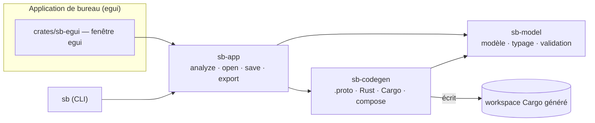
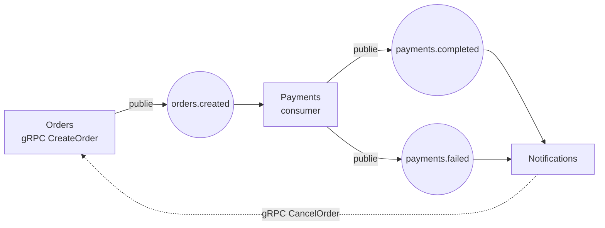
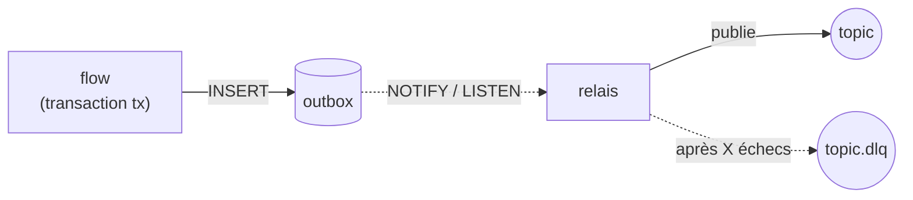

# Architecture

## Vue d'ensemble



| Crate / dossier | Rôle |
| --- | --- |
| `crates/sb-model` | Le document : `Project`, `Service`, `Topic`, `Message`, `Step`… (JSON camelCase), règles de nommage, typage léger des mappings, validation avec diagnostics. Aucune dépendance à l'interface ni au générateur. |
| `crates/sb-codegen` | Du modèle vers un workspace Cargo : `.proto`, crate `contracts`, crate `runtime` embarquée, un crate par service, `docker-compose.yml`. Pur et déterministe. |
| `crates/sb-app` | Services applicatifs partagés par l'app et le CLI `sb` : `analyze` (validation + génération + rustfmt), ouvrir/sauver, exporter, lancer en conteneurs (`pods`), serveur MCP, et la logique d'édition sans fenêtre : formulaires d'étapes (`stepform`), renommages en cascade (`rename`), portée des variables (`scope`). |
| `crates/sb-egui` | L'application (paquet `service-builder`, egui/eframe sur wgpu) au-dessus de `sb-app` : coque (`app.rs`, `header.rs`), pages (`pages/`), thème (`theme.rs`, `fonts.rs`, `icons.rs`), mise à jour (`updater.rs`). |

## Le modèle de projet

Un projet est un fichier JSON (`schemaVersion`, `messages`, `topics`, `services`). Les projets enregistrés par une version
plus ancienne sont migrés à l'ouverture (producteurs déclarés, types de schémas déduits : la charge utile d'un topic
devient un `event`, le reste un `proto`). C'est la seule source de
vérité : le canvas, l'inspecteur et le code généré en sont des vues.

- **Schémas** : un schéma est un ensemble de champs nommé, avec un **type** qui dit à quoi il sert :
  - `event` : la charge utile d'un topic Kafka ;
  - `proto` : une requête ou réponse gRPC, et les types partagés (un `Customer` imbriqué dans un événement et
    dans une requête, par exemple) ;
  - `api` : le corps, les paramètres et la réponse d'une route HTTP (voir [API HTTP](#api-http)) ; ils sont aussi lus et
    écrits en JSON.

  Les règles sont vérifiées : un topic ne transporte qu'un `event` (`E_TOPIC_MESSAGE_KIND`), un RPC n'utilise que
  des `proto` (`E_RPC_MESSAGE_KIND`), et les `api` ne se mélangent pas aux deux autres, ni en imbrication
  (`E_SCHEMA_KIND_MIX`). Les `event` et `proto` peuvent s'imbriquer (ils sont tous deux en protobuf), ce qui
  permet de copier un champ d'une requête vers un événement sans conversion. Tous les schémas sont des messages
  protobuf ; chaque champ a un **numéro stable** (`tag`) : une fois des événements écrits dans Kafka,
  renuméroter casserait les consumers. L'éditeur attribue un numéro à la création et ne le réutilise pas tant que le
  champ existe ; le générateur numérote les champs sans `tag` dans l'ordre.
- **Topics** : un topic transporte exactement un type de message ; un champ clé optionnel donne la clé de partition
  (l'ordre est garanti par clé).
  Un topic déclare ses **producteurs** : les services propriétaires de l'événement. Une étape *Publier* dans un
  autre service est une erreur (`E_NOT_PRODUCER`). On les déclare en tirant une flèche service → topic, dans la
  section « Producteurs » du topic, ou implicitement en ajoutant une étape *Publier* (le service est alors déclaré).
  Un producteur sans étape *Publier* donne un avertissement. Les projets enregistrés avant (`schemaVersion` 1) sont
  migrés à l'ouverture : tout service qui publiait sur un topic en devient producteur.
- **Services** : des RPC (gRPC), des routes HTTP, des consumers (Kafka) et des tâches planifiées. Chacun contient une **liste d'étapes**.
- **Étapes** : `log`, `let`, `publish`, `publishLive`, `callRpc`, `branch` (étapes imbriquées), `respond`, `fail`, `rateLimit` et `verifyHmac` (routes HTTP), `sql`, `hashPassword`, `verifyPassword`, `randomToken`, `sha256`, `encrypt`, `decrypt`, `signJwt`, `verifyJwt`, `jwks`, `code`.
  Une liste d'étapes est un arbre (pas un graphe arbitraire) : cela se génère en Rust structuré et s'édite comme
  une pile de blocs, comme dans un page builder.

### Noms

Les noms saisis deviennent des identifiants Rust, protobuf et Kafka. On n'accepte que les noms dont la
conversion est sans perte (`order_id` reste `order_id`, `HTTPServer` est refusé car prost le transformerait en
`HttpServer`). Ainsi `input.order_id` dans l'éditeur est exactement `input.order_id` dans le Rust généré.

### Expressions et typage

Une valeur est un **champ** (`input.customer.name`), un **littéral**, ou du **Rust brut**. Les deux premiers sont
typés (`sb-model/src/typing.rs`) : un chemin se résout champ par champ, et il peut remplir un champ cible s'il a le
même type, ou s'il s'élargit en `optional`. Les messages étant des `Option<Msg>` en prost, lire à travers un message
absent donne la valeur par défaut (`.as_ref().map(..).unwrap_or_default()`).

Un **`uuid`** est un texte (`string` en protobuf, `String` en Rust) qui a son propre type dans l'éditeur : un littéral
doit être un UUID bien formé (`8-4-4-4-12` chiffres hexadécimaux, sinon `E_TYPE_MISMATCH`), et une colonne `uuid` se
lit comme un `uuid`. Il se convertit librement vers et depuis `string` (les deux sont du texte, et refuser aurait cassé
les projets qui écrivent un texte dans une colonne `uuid`) : un texte qui n'en est pas un échoue à l'exécution, au
cast `$n::uuid` de la base. L'étape **Variable** (`let`) porte les indicateurs `optional` (`Option<T>`, le littéral
`null` pour « absent ») et `repeated` (`Vec<T>`, un tableau JSON pour littéral), jamais les deux (`E_LET_TYPE`) ; un
schéma peut être une liste mais jamais optionnel, sa présence étant implicite. Les chemins vers une variable
optionnelle ou liste suivent les règles ci-dessus : une valeur simple s'élargit en optionnelle, une liste ne remplit
qu'une liste.

Le Rust brut n'est pas typé : c'est l'échappatoire. Sa syntaxe est tout de même vérifiée avec `syn`, avec le chemin
exact de l'étape fautive.

`sb_app::scope` reprend ces règles pour **lister** les variables lisibles à une étape (dans les formulaires) ; le
validateur reste l'autorité.

### Diagnostics

Chaque diagnostic porte un `code` stable (`E_UNKNOWN_TOPIC`…), un message et un **JSON pointer** vers l'élément
(`/services/0/rpcs/1/steps/2/then/0`). L'UI s'en sert pour afficher le badge sur le bon nœud ou la bonne étape.

## Le code généré



- **Contrats** : un seul `.proto` (package = nom du projet). `protox` le compile en Rust pur, donc **pas de `protoc`**
  à installer. Les noms de topics deviennent des constantes (`topics::ORDERS_CREATED`).
- **Runtime** (`crates/sb-codegen/templates/runtime`) : écrit tel quel dans chaque export. Il contient tout ce qui
  n'a pas à varier : producer idempotent, création des topics au démarrage (avec attente du broker),
  `consume()` at-least-once avec 3 essais puis DLQ, et l'[outbox](#persistance-et-outbox).
- **Un service = un binaire**, organisé par responsabilité :

  ```
  services/payments/src/
  ├── main.rs              la séquence de démarrage, rien d'autre
  ├── app/                 config.rs (env), ctx.rs (base de données + clients gRPC), bootstrap.rs (topics, base, attente)
  ├── transport/           comment l'extérieur atteint le service
  │   ├── grpc.rs          le serveur tonic : traduit et délègue à flows::rpc
  │   ├── http.rs          les routes pour le front (axum) : traduit le JSON et délègue à flows::api
  │   ├── kafka.rs         les abonnements : topic, groupe, type de message → flows::consumers
  │   └── outbox.rs        le relais qui publie les événements mis en file par les flows
  └── flows/               la logique dessinée : rpc.rs, api.rs, consumers.rs (une fonction par RPC, route ou consumer)
  ```

  Un transport ne contient aucune logique métier et les flows ne connaissent ni tonic ni rdkafka : ajouter un
  transport (WebSocket, par exemple) ne touche pas aux flows. Les fichiers inutiles ne sont pas générés (pas de
  `grpc.rs` sans RPC, pas de `http.rs` sans route, pas de `kafka.rs` sans consumer, pas de `outbox.rs` si le service ne publie rien).
- Les adresses se règlent par variables d'environnement : `KAFKA_BROKERS`, `<SERVICE>_PORT`, `<SERVICE>_HTTP_PORT`,
  `<SERVICE>_URL`, `<SERVICE>_DATABASE_URL`, `OUTBOX_MAX_ATTEMPTS`, `CORS_ORIGINS`.

### API HTTP

Un service peut aussi recevoir des requêtes **HTTP du front** : ce sont ses **routes** (section « API HTTP » de
l'inspecteur), à côté des RPC et des consumers. Une route a une méthode (`GET`, `POST`, `PUT`, `PATCH`, `DELETE`), un
chemin, un schéma `api` de requête, un schéma `api` de réponse, un statut de succès (200, 201 ou 202) et une liste
d'étapes, exactement comme un RPC (y compris *Publier* : l'événement passe par l'outbox).

- **De la requête au schéma** : `input` est le schéma de requête. Les `{param}` du chemin remplissent le champ du même
  nom (chaîne, booléen, int32 ou int64, obligatoire) ; les autres champs viennent du **corps JSON** (`POST`, `PUT`,
  `PATCH`) ou de la **query string** (`GET`, `DELETE`, champs simples uniquement).
- **En-têtes et cookies** : un champ texte obligatoire (`string` ou `uuid`) d'un schéma `api` peut être lu d'un **en-tête**
  de la requête (`Authorization`, `X-Request-Id`…, quelle que soit la casse) ou d'un **cookie** (percent-décodé, comme le
  génère `Cookie`) plutôt que du corps (`source`, « Lu depuis » dans l'éditeur). La route **écrase toujours** le champ,
  vide si la requête ne l'a pas : un client ne peut pas faire passer pour un en-tête ce qu'il met dans le corps ou la query
  string. Les règles du champ s'appliquent ensuite. Pour un cookie en double, le premier gagne. Validation : schéma `api`
  (`E_SOURCE_KIND`), texte unique et obligatoire (`E_SOURCE_TYPE`), nom valable (`E_SOURCE_NAME`), pas aussi un paramètre
  du chemin (`E_SOURCE_PARAM`), et `W_SOURCE_UNUSED` quand aucune route ne reçoit directement le schéma.
- **JSON** : les noms de champs sont ceux du schéma, sans conversion (`order_id` reste `order_id`). Un champ absent de
  la requête prend sa valeur par défaut. `bytes` et `timestamp` n'ont pas encore de forme JSON dans les schémas API.
- **Erreurs** : `{ "error": "..." }`. L'étape **Refuser** (`fail`) arrête la route avec un statut d'erreur (400 à 599) et
  un message fixe ; elle compte comme une réponse (pas d'avertissement `W_NO_RESPOND`), et ce que la route avait écrit en
  base ou publié est annulé avec la transaction. `retryAfter` (secondes, un champ ou un littéral) pose l'en-tête
  `Retry-After` et ne va qu'avec 429 et 503 (`E_FAIL_RETRY_AFTER`). Pour un statut 5xx, le message reste dans les
  journaux et le client reçoit un texte générique. Validation : statut d'erreur (`E_FAIL_STATUS`), message non vide
  (`E_FAIL_MESSAGE`), routes seulement (`E_FAIL_OUTSIDE_ROUTE`). Dans une étape *Code Rust*, on choisit le statut avec
  `return Err(eda_runtime::http::HttpError::not_found("...").into())` ; toute autre erreur donne un 500 dont le détail
  reste dans les journaux.
- **Réponse** : l'étape *Répondre* d'une route peut choisir son **statut** de succès (200, 201 ou 202, sinon celui de la
  route, `E_RESPOND_STATUS`) et poser des **cookies**. Un cookie est sûr par défaut : `HttpOnly`, `Secure`, `SameSite=Lax`,
  `Path=/` ; chaque attribut se relâche à part, et `SameSite=None` exige `Secure` (`E_COOKIE_SAMESITE`). `maxAgeSecs` donne
  la durée (`0` supprime le cookie, absent : cookie de session). La valeur est du texte, encodée en pourcentage côté
  runtime : un `;` dans une valeur ne peut pas ajouter d'attribut. Le flow d'une route qui pose un statut ou des cookies
  renvoie un `eda_runtime::http::Reply` ; les autres gardent leur forme. Validation : `E_COOKIE_NAME`,
  `E_COOKIE_DUPLICATE`, `E_COOKIE_PATH` ; statut et cookies sont refusés hors d'une route (`E_RESPOND_ROUTE_ONLY`).
- **Limiter le débit** : l'étape `rateLimit` compte chaque essai sous une **clé** (un texte : l'e-mail, une adresse, ou un
  littéral pour tout le monde) et, au-delà de `max` essais dans les `windowSecs` dernières secondes (1 à 86 400), répond
  `429` avec `Retry-After` (secondes à attendre). Fenêtre glissante, une par étape et par clé ; un essai refusé n'est pas
  compté. Le compte vit **en mémoire de chaque instance** : avec plusieurs réplicas la limite réelle est multipliée d'autant
  (un magasin partagé, Valkey par exemple, est un prochain pas). Les clés inactives sont oubliées toutes les minutes.
  Routes seulement (`E_RATE_LIMIT_OUTSIDE_ROUTE`), `E_RATE_LIMIT_MAX`, `E_RATE_LIMIT_WINDOW`.
- **Règles de champ** : un champ texte (`string`, `uuid`) d'un schéma API peut porter des règles (`rules`), vérifiées par le
  handler généré **avant toute étape**, dans l'ordre des champs ; la première qui échoue répond `400 { "error": "champ : … " }`.
  - `length` (`min`, `max`) : entre `min` et `max` **caractères** (pas octets), texte rogné avant d'être compté ; la borne
    haute est ce qui empêche un mot de passe gigantesque d'arriver jusqu'à argon2 (`E_RULE_LENGTH` si elle est
    impossible à satisfaire) ;
  - `email` : `local@domaine.tld`, 254 caractères au plus, sans espace ni second `@` : un contrôle de forme, seul un message
    envoyé à l'adresse dit si elle existe ;
  - `siren` : 9 chiffres et clé de Luhn valide.
  Un champ optionnel n'est vérifié que s'il est présent, une liste élément par élément, un schéma imbriqué par ses propres
  règles, avec le chemin dans le message (`company.name : …`). Chaque sorte de règle une fois par champ (`E_RULE_DUPLICATE`) ;
  seulement sur des champs texte (`E_RULE_TYPE`) de schémas API (`E_RULE_KIND`) ; et un schéma dont les règles ne sont jamais
  vérifiées, parce qu'aucune route ne le reçoit, directement ou imbriqué, donne `W_RULE_UNUSED`.
- **Webhooks signés** : l'étape `verifyHmac` authentifie une route par la signature de son **corps brut**, sans session
  (`POST /webhook/stripe`). La signature est le HMAC-SHA256 de `horodatage.corps`, envoyée dans l'en-tête choisi sous la
  forme `t=<secondes unix>,v1=<hex>` (le schéma de Stripe ; plusieurs `v1=` sont acceptés, pendant la rotation d'un
  secret). Le secret est lu dans la variable d'environnement indiquée, et **le service ne démarre pas sans elle**.
  L'horodatage doit être à moins de `toleranceSecs` (300 par défaut) de l'horloge du service, ce qui arrête le rejeu. Toute
  signature absente, illisible, périmée ou fausse répond `401 invalid signature` sans dire laquelle (la raison va dans les
  journaux) ; la comparaison est en temps constant. Un corps correctement signé mais qui n'est pas le JSON attendu répond 400.
  Le handler généré lit les octets, vérifie, puis seulement désérialise : l'étape est donc **la première de la route**, une
  seule fois, et la route a un corps (POST, PUT, PATCH) ; sinon `E_HMAC_POSITION`, `E_HMAC_DUPLICATE`, `E_HMAC_METHOD`.
  Aussi `E_HMAC_HEADER`, `E_HMAC_SECRET_ENV`, `E_HMAC_TOLERANCE` et `E_HMAC_OUTSIDE_ROUTE`. Seul ce schéma est géré ; un
  autre (GitHub, Shopify) demanderait un autre format d'en-tête.
- **CORS** : les origines autorisées se règlent avec `CORS_ORIGINS` (`*` par défaut, à restreindre en production).
- **Ports** : chaque service a un port HTTP (`<SERVICE>_HTTP_PORT`), distinct des autres ports du projet. gRPC et HTTP
  tournent dans le même processus.
- **Validation** : chemin bien formé (`E_ROUTE_PATH`), pas deux routes de même méthode et même forme
  (`E_DUPLICATE_ROUTE`), paramètres présents dans la requête (`E_ROUTE_PARAM`), query string limitée aux champs
  simples (`E_ROUTE_QUERY_FIELD`), schémas de type `api` (`E_ROUTE_SCHEMA_KIND`).

**Le configurateur d'endpoint.** Cliquer une route (sur un service du canvas, dans l'arbre à gauche, ou en créer une)
remplace le canvas par un écran en deux colonnes : à gauche la **logique** (les étapes de la route), à droite le
**contrat JSON** : la requête (chaque champ dit d'où il vient : chemin, query ou corps) et la réponse, chacune avec
l'édition de son schéma et un exemple de JSON. La **réponse est produite par la logique** : sous le JSON, chaque champ lit
une valeur calculée par les étapes (l'étape « Répondre »). Pour une réponse qui demande plusieurs requêtes (plusieurs
tables, des listes), « Construire la réponse par la logique » ajoute une variable du type du schéma de réponse,
remplie en Rust avec `tx`, dont chaque champ alimente la réponse ; le bloc SQL le fait sans écrire de Rust. Une variable peut en effet porter un schéma entier,
construit en Rust (`E_LET_VALUE` si on essaie autre chose). « ← Architecture » ramène au canvas.

Pas encore : authentification, validation des champs obligatoires, pagination, spécification OpenAPI, jointures
entre tables dans le bloc SQL (une requête plus riche s'écrit en Rust avec `tx`).

### Tables et bloc SQL

Chaque service a sa base ; la vue **Tables** (onglet de la barre du haut) sert à concevoir ses tables : colonnes,
type (`string`, `bool`, `int32`, `int64`, `float`, `double`, `timestamp`, `uuid`, `jsonb`), nullable, clé primaire,
valeur par défaut SQL. Le SQL de la table est affiché à côté. Au démarrage, le service applique le schéma de façon
**additive** : `CREATE TABLE IF NOT EXISTS` puis `ADD COLUMN IF NOT EXISTS` pour chaque colonne, donc une colonne
ajoutée dans la conception arrive dans une base existante (elle est nulle par défaut, pour ne pas échouer sur des lignes
déjà là). Renommer ou supprimer une colonne ne modifie pas les tables déjà créées.

Une table porte aussi trois listes de contraintes, appliquées **après** toutes les tables et toutes les colonnes (une
clé étrangère peut donc viser une table définie plus loin) :

- **`UNIQUE`** (`uniques`) : une contrainte nommée sur une ou plusieurs colonnes ;
- **index** (`indexes`) : un index nommé sur une ou plusieurs colonnes, éventuellement `unique` ; l'ordre des colonnes
  est celui de l'index ;
- **clés étrangères** (`foreignKeys`) : `columns[i]` référence `refColumns[i]` de `refTable`, dans la base du même
  service. Elles peuvent être **composites**, avec `onDelete` / `onUpdate` (`noAction`, `restrict`, `cascade`,
  `setNull`, `setDefault`).

Postgres n'a pas de `ADD CONSTRAINT IF NOT EXISTS` : les contraintes `UNIQUE` et les clés étrangères sont ajoutées dans
un bloc `DO $$ … $$` qui teste d'abord `pg_constraint`, les index avec `CREATE [UNIQUE] INDEX IF NOT EXISTS`. Le
démarrage reste donc rejouable. Comme pour les colonnes, c'est additif : retirer une contrainte du projet ne la supprime
pas d'une base existante, et une contrainte déjà créée n'est pas modifiée si on change ses colonnes sans changer son nom.

Règles vérifiées (`validate.rs`) : un nom de contrainte ou d'index est en snake_case, 63 caractères au plus, et partage
l'espace de noms du service avec les tables (`E_DUPLICATE_CONSTRAINT`, `E_CONSTRAINT_NAME`) ; les colonnes existent, sans
doublon (`E_CONSTRAINT_UNKNOWN_COLUMN`, `E_CONSTRAINT_DUPLICATE_COLUMN`, `E_CONSTRAINT_NO_COLUMNS`) ; une clé étrangère
vise une table du service (`E_FK_UNKNOWN_TABLE`), associe autant de colonnes que de colonnes visées (`E_FK_ARITY`), de
même type deux à deux (`E_FK_TYPE`), et ces colonnes visées forment la clé primaire, une contrainte `UNIQUE` ou un
index unique de la table cible, dans n'importe quel ordre (`E_FK_NOT_UNIQUE`) ; `setNull` exige des colonnes nullables
(`E_FK_SET_NULL`) et `setDefault` des colonnes avec défaut (`E_FK_SET_DEFAULT`). Dans la vue Tables, ces diagnostics
s'affichent sous la contrainte concernée, et renommer une table ou une colonne suit les contraintes qui la citent.

Deux réglages de table, pour les données qui appartiennent à un tenant et qu'on ne supprime pas vraiment :

- **`tenantColumn`** : une colonne obligatoire de type texte (`string` ou `uuid`, `E_TENANT_COLUMN`). Tout bloc SQL sur la table
  est **filtré par cette colonne** (`AND tenant_id = $n`) et toute insertion la renseigne, à partir de la variable **du même nom**
  que le flux a liée avant (`let tenant_id` depuis le jeton vérifié) : l'auteur ne peut pas l'oublier, ni lire, modifier ou
  supprimer les lignes d'un autre tenant avec ces blocs. Sans cette variable, ou d'un autre type, c'est `E_TENANT_SCOPE` ; écrire la
  colonne dans les valeurs (ce qui déplacerait la ligne chez un autre) ou la filtrer soi-même est refusé (`E_TENANT_MANUAL`). Elle
  n'est pas exigée dans les valeurs d'une insertion : le générateur la pose. **Une valeur vide est une valeur** : un jeton sans tenant
  donnerait des lignes sans tenant, à refuser avant (la vitrine : un `Fail 403` si `claims.tid` est vide).
- **`softDelete`** : la table a une colonne `deleted_at`, timestamp nullable (`E_SOFT_DELETE_COLUMN` ; l'éditeur l'ajoute en
  cochant la case). Une suppression devient `UPDATE … SET deleted_at = now() WHERE … AND deleted_at IS NULL` (le `RETURNING` rend
  toujours la ligne, une seconde suppression est « introuvable » et ne déplace pas la date) ; lectures, mises à jour et suppressions
  ignorent les lignes datées. Écrire `deleted_at` soi-même est refusé (`E_SOFT_DELETE_MANUAL`). Les contraintes `UNIQUE` et les clés
  primaires continuent de compter les lignes supprimées : un e-mail supprimé ne peut pas être recréé tel quel.

Ces filtres ne s'appliquent qu'aux blocs SQL : un bloc *Code Rust* qui écrit sa propre requête les contourne. Les clés
étrangères composites `(tenant_id, id)` qui empêchent une ligne de viser un autre tenant s'ajoutent à la main (voir plus haut).
Vérifié sur le code généré avec PostgreSQL : un tenant ne lit ni ne supprime la note d'un autre (404), la suppression laisse la
ligne datée, une seconde suppression est un 404 qui ne change pas la date.

Une colonne **`jsonb`** est un document JSON que les flux voient comme du texte, comme `timestamp` : lue avec
`col::text`, écrite avec `$n::jsonb` (un texte qui n'est pas du JSON fait échouer la requête à l'exécution, Postgres le
refuse). Postgres normalise le document (l'ordre des clés n'est pas conservé).

Le bloc **SQL** est un bloc de logique à part entière. Il lit une table du service dans la transaction du handler :

- **Lire** : on coche les colonnes. Le bloc est **prédictif** : la variable (`order`) est typée d'après les colonnes
  cochées, donc `order.status` est proposé dans les étapes suivantes (et refusé si la colonne n'est plus cochée,
  `E_UNKNOWN_PATH`). Une colonne nullable donne un champ optionnel ; `timestamp` et `jsonb` se lisent en
  texte (ISO 8601 pour les dates), `uuid` comme un `uuid`. Une seule ligne (`404` si aucune ne correspond) ou **plusieurs** (liste, à convertir vers
  un schéma avec « Vers un schéma » : les colonnes de même nom remplissent ses champs, `E_SQL_INTO_FIELD` sinon),
  avec tri et limite. À la création du bloc, la condition est déjà posée : la clé primaire est rapprochée de la
  valeur de même nom dans la requête (`order_id = input.order_id`).
- **Insérer / Modifier / Supprimer** : les valeurs sont typées par leur colonne, une colonne obligatoire sans défaut
  doit recevoir une valeur (`E_SQL_MISSING_VALUE`), et une modification ou une suppression **sans condition** est
  refusée (`E_SQL_NO_WHERE`).

- **Renvoyer la ligne** (`RETURNING`) : un *Insérer*, *Modifier* ou *Supprimer* peut donner en retour les colonnes cochées
  de la ligne écrite, dans la **même instruction**, et la lier à une variable typée comme celle d'une lecture (liste,
  « vers un schéma » : mêmes règles). C'est ce qui rend atomique la consommation d'un jeton à usage unique (vérification
  d'e-mail, réinitialisation de mot de passe, invitation) : `UPDATE auth_tokens SET used = true WHERE token_hash = … AND
  used = false AND expires_at > now() RETURNING account_id`. Un `SELECT` puis un `UPDATE` laisseraient une fenêtre où deux
  requêtes simultanées passent toutes les deux ; avec une seule instruction, la seconde attend le verrou de la ligne,
  relit `used = true` et ne renvoie rien (vérifié sur PostgreSQL avec deux sessions concurrentes).
- **Maintenant** (`now()`) : une valeur ou une condition d'un bloc SQL peut être l'horloge de la base, pour une colonne
  `timestamp` seulement (`E_NOW_COLUMN`) ; ailleurs, c'est `E_NOW_OUTSIDE_SQL`. Elle n'ajoute aucun paramètre : `now()`
  est écrit dans la requête. Utiliser l'horloge de la base plutôt que celle du service évite les décalages entre instances.
- **Si aucune ligne** : quand un bloc attend **une** ligne (une lecture, ou un `RETURNING`) et n'en trouve pas, la route
  répond 404 par défaut. Une route peut choisir autre chose (`missing` : un statut d'erreur et un message fixe), par exemple
  un 400 « jeton invalide ou expiré » identique pour un jeton inconnu, expiré ou déjà utilisé, ou un 401 identique pour un
  compte inconnu. Routes seulement, et seulement pour une ligne : `E_SQL_MISSING_OUTSIDE_ROUTE`, `E_SQL_MISSING_USELESS`,
  `E_SQL_MISSING_STATUS`, `E_SQL_MISSING_MESSAGE`.

Les requêtes sont paramétrées (`$1`, `$2`…) : aucune valeur n'est collée dans le SQL. Techniquement, la ligne lue par un
bloc est un message dérivé (`OrdersRowH6`) que `Project::with_sql_rows` ajoute au projet avant la validation et la
génération ; il n'est jamais écrit dans un fichier projet ni dans le `.proto`.

### Mots de passe et jetons

Six étapes lient une variable à partir d'un secret. Elles appellent le module fixe `eda_runtime::crypto`, livré dans le
workspace généré (avec ses propres tests : `cargo test -p eda-runtime`), et valent dans tous les handlers.

- **Hacher un mot de passe** (`hashPassword`) : argon2id, en `spawn_blocking` (il est lent exprès et gèlerait sinon les
  autres requêtes du runtime). La variable est la chaîne `$argon2id$…` à stocker. Au-delà de 1 024 octets, la requête est
  refusée en 400 avant tout calcul : un mot de passe gigantesque serait un déni de service.
- **Vérifier un mot de passe** (`verifyPassword`) : une variable `bool`. Le hash enregistré peut être absent (compte
  inconnu, littéral `null`) : la vérification tourne alors contre un hash factice et répond faux, donc elle prend le même
  temps qu'un vrai refus et le délai ne révèle pas quels comptes existent. Un texte qui n'est pas un hash ne correspond jamais.
- **Jeton aléatoire** (`randomToken`) : 256 bits en 64 caractères hexadécimaux.
- **Empreinte SHA-256** (`sha256`) : 64 caractères hexadécimaux. Un jeton est déjà très aléatoire, un hash rapide suffit :
  on stocke l'empreinte, jamais le jeton.

- **Chiffrer** / **Déchiffrer** (`encrypt`, `decrypt`) : AES-256-GCM, pour ce qui est stocké au repos (un secret TOTP, un
  jeton d'API). Le résultat est `hex(nonce ‖ texte chiffré ‖ étiquette)` : le nonce est **aléatoire à chaque appel**, donc le
  même texte ne donne jamais deux fois le même résultat. La clé fait 32 octets, en 64 caractères hexadécimaux, dans la
  variable d'environnement `keyEnv` (`E_KEY_ENV`) : **le service ne démarre pas** si elle manque ou si elle est mal formée. Une
  clé différente, une valeur tronquée ou la moindre altération (nonce, texte ou étiquette) est une erreur interne : ce qui est
  stocké n'a pas été écrit par ce service, ou a été modifié. Le format est celui d'AES-GCM : le runtime déchiffre un texte
  scellé par une autre implémentation (vérifié avec la bibliothèque `cryptography` de Python). Il n'y a pas de rotation de clé :
  changer la clé rend illisible ce qui a été chiffré avec la précédente.

- **Jetons d'accès (JWT)** : `signJwt` émet un access token signé en **Ed25519 (EdDSA)**, vérifiable sans base de données.
  Les claims sont ceux de l'auteur (`sub`, `tid`, `roles`… : texte, nombre, booléen ou liste, chacun avec son type) ;
  `iss`, `iat` et `exp` sont posés par l'étape et ne peuvent pas être surchargés, et `sub` est obligatoire (`E_JWT_NO_SUB`).
  La graine fait 32 octets (64 caractères hexadécimaux) dans la variable d'environnement indiquée, et le service ne démarre
  pas sans elle.
  - `verifyJwt` (routes seulement) lit le jeton d'une expression, souvent un champ lu de l'en-tête `Authorization`
    (`bearer` en retire alors le mot `Bearer`) ou d'un cookie (voir *En-têtes et cookies*). Il
    **impose l'algorithme** : ni `none`, ni HS256 signé avec la clé publique. Émetteur, expiration (5 s de tolérance) et `sub`
    sont vérifiés ; la clé est choisie par le `kid` du jeton. Tout refus est le même `401 invalid token`. Les claims sont lus
    comme un **schéma API** que l'auteur déclare (`AccessClaims` : `sub`, `roles`…) : ils sont ensuite typés dans les étapes
    suivantes (`claims.roles`). Un claim absent prend la valeur par défaut de son champ ; un claim d'un autre type est un 401.
  - Les clés viennent soit **des graines de ce service** (il vérifie ce qu'il signe), soit du **JWKS du service qui signe**,
    dont l'URL (`http://…`, en réseau interne) est lue dans une variable d'environnement : elle est chargée une fois, puis de
    nouveau quand un jeton nomme un `kid` inconnu (une rotation), au plus toutes les 10 secondes pour qu'un flot de `kid`
    inventés ne fasse pas charger sans fin. Pas de TLS dans ce client.
  - `jwks` publie les clés publiques dans une variable du schéma API `Jwks` (une liste de `Jwk` : `kty`, `crv`, `alg`, `kid`, `x`),
    que l'éditeur crée au besoin ; une route publique la sert, par exemple `GET /.well-known/jwks.json`. Jamais de paramètre
    privé. La première graine signe : pour une **rotation**, on met la nouvelle en premier et on garde l'ancienne publiée
    jusqu'à l'expiration de ses jetons. Le `kid` dérive de la clé publique, donc il est le même sur toutes les instances.
  Vérifié sur le code généré, avec PostgreSQL : connexion (limite de débit, hash lu en base, vérification, cookie, jeton),
  `/whoami` avec le jeton, JWKS qui vérifie le jeton sans la graine ; jeton altéré, absent ou invalide, mauvais mot de passe et
  compte inconnu donnent des réponses identiques. Le jeton lu dans `Authorization: Bearer` ou dans le cookie `access_token`
  est accepté (casse du schéma et de l'en-tête indifférente, cookies répartis sur plusieurs en-têtes) ; le même jeton glissé
  dans la query string, ou un en-tête sur la route qui lit le cookie, donne un 401.

- **Second facteur (TOTP)** : quatre étapes pour une application d'authentification (RFC 6238 : HMAC-SHA1, 6 chiffres, pas de
  30 s, ce que lisent toutes les applications). Le runtime les implémente lui-même (`totp.rs`) et reproduit les vecteurs de test
  du RFC.
  - `totpGenerate` tire un secret de 160 bits et le **chiffre** (AES-256-GCM, clé en variable d'environnement, vérifiée au
    démarrage) : il faut pouvoir le relire pour vérifier un code, donc jamais de hachage. La variable reçoit le schéma API
    `TotpSetup` (que l'éditeur crée) : `sealed` à stocker, `otpauth_url` dont le client fait le QR code, `secret` en base32 pour la
    saisie manuelle. Les deux derniers ne sont jamais conservés. L'émetteur ne contient pas de deux-points
    (`E_TOTP_ISSUER`).
  - `totpVerify` (routes seulement, `E_TOTP_OUTSIDE_ROUTE`) accepte le code du pas précédent, courant ou suivant, compare **tous**
    les pas en temps constant et ignore les espaces saisis. **Anti-rejeu** : un code n'est accepté que pour un pas plus récent que
    le dernier accepté du compte, enregistré par une seule instruction SQL atomique dans la transaction du handler (table
    `totp_steps`, créée avec le schéma du service) : deux requêtes simultanées avec le même code ne passent pas toutes les deux, et
    un échec de la route annule l'enregistrement. Code faux, rejoué, mal formé, compte sans secret : le même `401 invalid code`.
    La limite de tentatives est un `rateLimit` placé avant (la vitrine : 5 par 15 minutes et par compte).
  - `recoveryCodes` émet 1 à 20 codes `XXXXX-XXXXX` (10 caractères base32, 50 bits) et efface ceux du compte ; la variable est une
    liste de textes, à montrer une fois. Seules leurs empreintes, **salées par compte**, sont stockées (table `recovery_codes`).
    `recoveryCodeUse` (routes seulement) en dépense un, saisi avec ou sans tiret, en majuscules ou non : une instruction
    `UPDATE … WHERE used_at IS NULL`, donc il ne sert qu'une fois même présenté deux fois en même temps. Un code inconnu, dépensé
    ou d'un autre compte : le même 401.
  Vérifié sur le code généré avec PostgreSQL : le code calculé par Python (bibliothèque standard seule) est accepté, le même code
  rejoué est refusé, comme un code faux ou un compte inconnu (réponses identiques) ; la base ne contient ni le secret ni les codes
  de récupération en clair ; huit requêtes simultanées avec le même code n'en laissent passer qu'une ; la sixième tentative d'un
  compte est un 429.

- **Passkeys (WebAuthn)** : quatre étapes, deux requêtes pour s'enregistrer et deux pour se connecter (routes seulement,
  `E_PASSKEY_OUTSIDE_ROUTE`). Le navigateur fait le travail cryptographique, le runtime (`webauthn.rs`, sur `webauthn-rs`)
  vérifie. Le domaine (RP ID) et l'origine viennent de la variable d'environnement `APP_URL` (et `APP_NAME` pour le nom
  affiché), la même que celle des liens des e-mails : le service ne démarre pas sans elle (`check_config`), sauf à nommer
  l'origine par requête (voir « Plusieurs frontends »).
  - `passkeyRegisterStart` (compte déjà authentifié : le prendre d'un jeton vérifié, `claims.sub`, jamais du corps) et
    `passkeyLoginStart` remplissent le schéma API `PasskeyChallenge` (créé par l'éditeur) : `state_id`, à rendre à l'étape de
    fin, et `options`, le JSON de `navigator.credentials.create` ou `.get`. Un appareil déjà enregistré par le compte est exclu.
  - `passkeyRegisterFinish` et `passkeyLoginFinish` reçoivent l'identifiant du défi et la réponse du navigateur (son JSON,
    transmis comme un texte). L'état du défi est gardé 5 minutes dans `webauthn_states` et **consommé par un seul
    `DELETE … RETURNING`** : un défi se termine une fois, une réponse ne se rejoue pas ni contre un autre défi. Un défi
    d'enregistrement n'est consommé que par le compte pour lequel il a été émis. La clé d'un appareil (`credential_id`,
    unique dans toute la table `webauthn_credentials`) ne peut être que sur un compte. La fin d'enregistrement refuse en
    `400 invalid passkey`, la fin de connexion en `401 invalid passkey` (même réponse faux, rejoué, expiré ou mal formé) ;
    elle donne le compte du défi, auquel on signe un jeton, et tient à jour le compteur de signature.
  - Un compte sans passkey reçoit un 401 au début de connexion, ce qui révèle qu'il n'en a pas : à protéger par un
    `rateLimit` (la vitrine : 10 par 15 minutes).
  - **Connexion sans identifiant (passkey « découvrable »)** : `passkeyLoginStart` **sans `account`**. Le défi ne nomme
    personne (pas d'`allowCredentials`, vérification de l'utilisateur exigée, `mediation: "conditional"` pour le
    remplissage automatique ; un bouton marche aussi) : l'appareil propose ses passkeys pour le site. La fin de connexion est
    la **même étape** `passkeyLoginFinish`, qui reconnaît le cas au type d'état (`discover`, sans compte). Le compte est celui
    **pour lequel la passkey a été stockée** (retrouvée par `credential_id`), jamais ce que dit le client : son `userHandle`
    ne sert qu'à recouper (il doit être celui du compte de la passkey, sinon 401) et la signature est vérifiée avec la clé
    stockée. Un défi de l'un ne termine pas l'autre. Même `401 invalid passkey` pour tout refus, un `credential_id` inconnu
    compris, donc rien ne dit si une passkey existe. Comme il n'y a pas de compte sur lequel compter les essais, le
    `rateLimit` se fait sur le client (la vitrine : l'en-tête `X-Forwarded-For`, fiable derrière un proxy qui le fixe) ; chaque
    début garde un état cinq minutes, nettoyé au début suivant.
  - L'enregistrement demande `residentKey: "preferred"` (options modifiées après la bibliothèque, qui n'en demande aucune) : sans
    cela un appareil peut créer une clé qu'il ne sait pas proposer sans compte. « Préféré » et non « exigé » : un appareil qui
    ne peut pas s'enregistre quand même, mais ne sera pas retrouvé sans compte. Les passkeys déjà enregistrées avant ce
    changement ne sont découvrables que si l'appareil les avait créées ainsi (les clés des gestionnaires de mots de passe et
    des téléphones le sont en général ; une clé de sécurité matérielle non).
  - **Plusieurs frontends (sous-domaines)** : par défaut le RP ID et l'origine sont ceux d'`APP_URL`, donc un seul frontend.
    Pour en servir plusieurs, deux ajouts, indépendants :
    - **Origine par requête** : les quatre étapes ont un champ optionnel `appUrl` (une expression, évaluée à chaque requête, par
      exemple depuis un en-tête qui nomme le frontend). Elle n'est acceptée que si elle est `APP_URL` ou figure dans la variable
      d'environnement **`WEBAUTHN_ALLOWED_ORIGINS`** (origines séparées par des virgules, comparées exactement : schéma, hôte et
      port ; un chemin est ignoré) ; sinon `400 invalid passkey` (au début, et à la fin d'un enregistrement), `401` à la fin
      d'une connexion. Pas de joker : une origine arbitraire ne peut pas être choisie par le client. **L'origine d'un défi est
      gardée avec lui** (colonne `webauthn_states.origin`, ajoutée par `ADD_STATES_ORIGIN` aussi sur une table existante) et la
      fin vérifie la réponse contre celle-là ; un `appUrl` à la fin qui en nomme une autre est refusé, et sans `appUrl` à la fin
      c'est celle du début. Un défi d'avant la colonne (origine vide) vaut `APP_URL`.
    - **Origines liées, un seul RP ID** : **`WEBAUTHN_RP_ID`** fixe le domaine parent (`exemple.fr`). Toutes les origines
      (`APP_URL` et la liste) doivent alors en être ou en dépendre (`check_config` refuse sinon, au démarrage), et la réponse d'un
      appareil est acceptée de n'importe laquelle : une passkey créée sur `exemple.fr` sert sur `app.exemple.fr`, et
      inversement. Un hôte dépend du RP ID à une frontière de label (`badexemple.fr` n'est pas sous `exemple.fr`).
      Sans `WEBAUTHN_RP_ID`, chaque origine demandée est son propre RP ID (ses passkeys ne servent pas ailleurs).
    Vérifié avec l'authentificateur logiciel et PostgreSQL : origine refusée, origine gardée avec le défi, fin avec une autre
    origine refusée, passkey créée sur `admin.exemple.fr` et utilisée depuis `app.exemple.fr`, réponse signée pour une origine
    hors liste refusée.
  - La fonctionnalité Cargo `webauthn` du runtime (qui apporte OpenSSL) n'est activée que dans le `Cargo.toml` des services
    qui ont une étape passkey ; `webauthn-tests` ajoute l'authentificateur logiciel des tests.
  Vérifié avec un authentificateur logiciel (vraies signatures, sans navigateur) puis sur le code généré avec PostgreSQL :
  enregistrement puis connexion, jeton d'accès valide pour le bon compte ; défi rejoué, jeton d'un autre compte, compte sans
  passkey, JSON invalide : refus ; la onzième tentative d'un compte est un 429.
  La connexion découvrable est vérifiée de la même façon (avec PostgreSQL, l'appareil logiciel étant complété côté client de
  test : il ne choisit pas seul une clé et ne rend pas de `userHandle`, ce que fait un vrai appareil) : deux appareils
  reconnus chacun pour son compte, défi à usage unique, réponse refusée contre un autre défi, `userHandle` d'un autre
  compte, clé d'un autre compte revendiquée avec une signature qui n'est pas la sienne, passkey inconnue, JSON invalide :
  401 chaque fois ; le test échoue si le recoupement du `userHandle` est retiré. **Pas essayé avec un vrai navigateur.**

- **Stockage objet (S3)** : pour les fichiers d'un utilisateur, la photo de profil par exemple, dans un bucket **privé**
  (Garage ou MinIO en développement, AWS en production). Ce qui traverse une étape est du **texte** : le contenu est en
  **base64** (alphabet standard), comme un client envoie un fichier dans une requête JSON et comme la réponse le rend.
  - `imageSniff` (routes seulement) reconnaît **PNG ou JPEG d'après les premiers octets** : le `Content-Type` du client n'est
    jamais cru, puisqu'il décide ensuite du type servi, et il n'y a **pas de SVG** (il peut porter du script). Image vide,
    au-dessus de `maxBytes` une fois décodée (1 octet à 10 Mio), d'un autre type, ou pas du base64 : `400`. Un texte très au-dessus
    de la limite est refusé sans être décodé. La variable reçoit le type (`image/png`). Comme l'image voyage en base64 dans le
    JSON, la limite de corps de la route (2 Mo par défaut chez axum) est relevée à la taille de l'image encodée plus 16 Kio, pour
    cette route seulement : une image de 2 Mio passe, une de 2 Mio + 1 octet est un 400, une de 6 Mio un 413.
  - `objectPut` (corps en base64, 10 Mio au plus, type `type/sous-type`), `objectGet` (la variable est le contenu en base64, ou
    **rien** si l'objet n'existe pas, ce qui n'est pas une erreur) et `objectDelete` (un objet absent n'est pas une erreur). La clé
    ne peut pas être vide, dépasser 1024 octets ni contenir de caractère de contrôle.
  - **Deux façons de servir un fichier.** Par l'API (`objectPut` / `objectGet` : les octets traversent le service, en base64) ou
    **en direct** : l'API vérifie les droits et **signe**, puis le front parle lui-même au stockage ou au CDN placé devant lui,
    si bien que le service reste léger (avatars, historique d'avatars, listes de PDF : N URL signées, zéro octet relayé).
    - `objectPresignGet` : la variable est une URL signée (SigV4) de lecture, valable `expiresSecs` (1 s à 7 jours). L'existence de
      l'objet n'est pas vérifiée (le stockage répond 404 au front) ; la signature est locale, aucun appel au stockage.
    - `objectPresignPut` : la variable est une URL signée d'écriture, sur laquelle le front fait un `PUT`. Le `Content-Type` et le
      `Content-Length` font partie de la signature : `size` (octets, annoncé par le front) est borné par `maxBytes` (1 à 10 Mio, `400`
      sinon) et le stockage refuse tout autre corps. Le type reste la parole du client (pas de reconnaissance par les premiers
      octets comme avec `imageSniff`) : ne pas le servir tel quel dans une page. À la charge du flux : écrire la ligne en base une
      fois l'envoi confirmé par le front (un objet sans ligne est inoffensif).
    - La signature porte l'hôte : `S3_PUBLIC_ENDPOINT` (une URL, vérifiée au démarrage) donne l'adresse que le front atteint, quand
      elle n'est pas celle du service (`S3_ENDPOINT`), par exemple un CDN ; sans elle, l'adresse du stockage.
  - Le nom du bucket est lu dans la variable d'environnement de l'étape, vérifiée au démarrage. `S3_ENDPOINT` (une URL) désigne un
    stockage compatible, adressé **par chemin** ; sans elle, AWS. Les identifiants sont la chaîne standard du SDK
    (`AWS_ACCESS_KEY_ID`, `AWS_SECRET_ACCESS_KEY`, `AWS_REGION`, `us-east-1` par défaut avec un endpoint), jamais dans le projet. Rien
    n'est demandé au stockage à la construction du client.
  - Un stockage injoignable est un **503** (le détail reste dans les journaux), pas un 500.
  - **Ordre des écritures** (à la charge du flux) : à l'envoi, l'objet d'abord puis la base (au pire un objet que la prochaine
    écriture remplace) ; à la suppression, la base d'abord puis l'objet (un objet que plus personne ne désigne est illisible,
    une ligne qui pointerait vers rien ne l'est pas).
  - La fonctionnalité Cargo `s3` du runtime (le SDK AWS, lourd à compiler) n'est activée que dans le `Cargo.toml` des services qui
    ont une étape objet ; `s3-tests` ajoute le faux S3 des tests.
  Vérifié avec un **faux S3 sur un port local** : le SDK parle vraiment HTTP, la requête est signée (SigV4) et le test le
  vérifie ; ni Garage ni AWS ne sont testés. Sur le code généré avec PostgreSQL : dépôt d'un PNG (octets identiques, type
  `image/png`), relecture, suppression ; SVG, GIF, texte, vide, 2 Mio + 1 octet : 400 ; 2 Mio exactement : 200 ; stockage arrêté : 503
  sans détail.

Choix : l'empreinte est du **texte hexadécimal** (colonne `string`), pas un `bytea`, car les flux n'ont pas de type
binaire ; la recherche d'un jeton se fait par `WHERE token_hash = …` dans un bloc SQL, sans étape de comparaison à part.
Le contrôle de longueur et de composition d'un mot de passe est la validation déclarative, pas ces étapes.

### Tâches planifiées

Un service peut avoir des **tâches** (`jobs`) : une période en secondes (de 1 à 30 jours, `E_JOB_INTERVAL`) et une liste
d'étapes. Il n'y a ni requête ni événement : pas de variable `input`, personne à qui répondre (`Répondre`, `Refuser` et
`Limiter le débit` sont refusés). Chaque passage tourne dans sa propre transaction, comme un handler, donc ce qu'il écrit
et ce qu'il publie sont validés ensemble.

- Le premier passage a lieu **au démarrage**, puis toutes les `everySecs` secondes. Si un passage est lent, les passages
  manqués ne sont pas rattrapés en rafale : le suivant attend une période pleine.
- Une erreur est journalisée et ne tue jamais la boucle.
- À l'arrêt du service (quelle qu'en soit la cause, y compris une erreur), les tâches finissent le passage en cours puis
  s'arrêtent.
- **Chaque instance** du service exécute la tâche. Ses étapes doivent donc pouvoir se répéter sans dommage : un `DELETE`
  de ce qui a expiré l'est, pas l'envoi d'un e-mail. Il n'y a pas d'élection d'une instance.

Le module `eda_runtime::jobs` (`spawn_periodic`) est livré dans le workspace généré avec ses tests, joués en temps simulé :
période, arrêt, erreur sans conséquence, pas de rafale de rattrapage. Une tâche se règle dans le panneau du service, section
« Tâches planifiées ».

### Consumers idempotents

Kafka livre **au moins une fois** : après un rééquilibrage ou un échec avant la validation de l'offset, un événement arrive
deux fois ; le relais de l'outbox peut aussi le publier deux fois. Un consumer peut donc désigner le **champ de
l'événement qui l'identifie** (`idempotentOn` : une chaîne, un `uuid`, un `int32` ou un `int64`, ni optionnel ni liste,
`E_IDEMPOTENT_FIELD`). Au début du flow, dans la transaction du handler, l'événement est enregistré dans
`processed_events (consumer, event_id)` avec `ON CONFLICT DO NOTHING` ; si la ligne existait déjà, le flow valide et
s'arrête : l'événement est ignoré.

- Le contrôle et les effets du premier traitement sont **dans la même transaction** : si le handler échoue, l'enregistrement
  est annulé avec le reste et la nouvelle livraison traite l'événement pour de bon. Deux livraisons simultanées ne peuvent pas
  gagner toutes les deux : la seconde attend la première, perd si elle valide, gagne si elle annule (testé sur PostgreSQL).
- Le champ est choisi par l'auteur, faute d'identifiant d'événement dans le pipeline. Il doit identifier l'**événement**, pas
  seulement l'entité : si deux événements différents portent le même `order_id`, le second serait ignoré.
- La table est créée avec le schéma du service (même s'il n'a aucune table dans la vue Tables), et les événements traités
  sont **oubliés au bout de 7 jours** (purge toutes les heures) : la table ne grossit pas sans fin.
- Les tests d'intégration du module `eda_runtime::dedup` sont livrés dans le workspace généré ; ils demandent une base :
  `EDA_TEST_DATABASE_URL=postgres://… cargo test -p eda-runtime -- --ignored`.

### Service mail (MTA)

Un service peut être **prêt à l'emploi** (`kind: "mta"`, tuile « Service mail » de la palette) : un agent de transfert de
courrier qui transforme des événements Kafka en e-mails. Ce n'est pas du code qu'on dessine : c'est du **code fixe**
(`crates/sb-codegen/templates/mta`, repris tel quel dans le service généré) avec **deux entrées de données** :

1. les **événements envoyés** : ce sont ses `consumers`, chacun avec une règle `mail` à la place des étapes ;
2. les **mails** : `templates`, un par événement (`eventType` = topic), des modèles [Tera](https://keats.github.io/tera/)
   rendus avec les champs de l'événement, tels que déclarés dans son schéma (`{{ name }}`).

Le fixe : file `mail_queue` (verrouillage `FOR UPDATE SKIP LOCKED`, reprises à délai croissant plafonné à 24 h, abandon après
5 essais), worker en parallèle, MIME multipart texte + HTML, **signature DKIM** RSA-SHA256, livraison **SMTP** directe vers le
MX du destinataire ou par un relais (`SMTP_HOST`), serveur SMTP entrant qui reçoit les **rebonds** (DSN) et les rattache au
message par son `Message-ID`, `/health` `/livez` `/readyz`, `/metrics` Prometheus (jeton `METRICS_TOKEN`). Les secrets (clé DKIM,
relais) sont dans l'environnement, jamais dans le projet ; le README généré liste les variables, et `docker-compose.yml` ajoute
Mailpit (SMTP sur 1025, interface sur 8025) pour voir les mails en développement.

**La règle d'un événement** (`MailRule`) : le champ qui porte l'**adresse** (facultatif : sans adresse l'événement est ignoré
au lieu d'être une erreur), le champ qui **identifie** l'événement, et quoi faire sans identité (`recipient`,
`topicAndRecipient`, `reject`), éventuellement un champ « entreprise » (l'expéditeur s'affiche `entreprise via <nom>`) et un
champ `Reply-To`. La clé de déduplication est `topic:identité` ; elle est **unique** dans la file : un événement redélivré par
Kafka (au moins une fois) ne part qu'une fois, un autre événement du même topic part. Un événement sans adresse ou sans
identité exigée échoue, est retenté puis **parqué sur `<topic>.dlq`** au lieu de bloquer la partition. L'événement est lu
comme le JSON de son schéma (les contrats dérivent `serde` pour ces messages), donc un champ `timestamp` n'y est pas encore
permis (`E_MTA_EVENT_FIELD`).

**Les mails** sont copiés dans la table `mail_templates` **au démarrage** s'ils n'y sont pas encore (`ON CONFLICT DO NOTHING`) :
le worker les relit à chaque cycle, donc un mail modifié **en base** s'applique sans redémarrage et n'est jamais écrasé par
un redéploiement ; un mail ajouté au projet arrive au démarrage suivant. C'est du code et non une migration `sqlx` : un fichier
de migration déjà appliqué ne peut plus changer (son empreinte est vérifiée), alors que les mails du projet changent. Le HTML est
échappé, le sujet et le texte ne le sont pas (`| safe` sur un lien du HTML). Un modèle qui ne compile pas est refusé à la
génération (`E_MTA_TEMPLATE_SYNTAX`), pas au premier envoi.

Validation : un service mail n'a ni RPC, ni route, ni table, ni tâche (`E_MTA_CONTENT`) et un port HTTP (`E_HTTP_PORT`) ; chaque
événement a une règle et pas d'étapes (`E_MTA_RULE`, `E_MTA_STEPS`) dont les champs existent et sont du texte
(`E_MTA_FIELD`, `E_MTA_FIELD_TYPE`) ; un topic n'a qu'un mail (`E_MTA_DUPLICATE_EVENT`) ; chaque événement a son mail et chaque mail son
événement (`E_MTA_TEMPLATE_MISSING`, `E_MTA_TEMPLATE_UNKNOWN`, `E_MTA_TEMPLATE_DUPLICATE`), avec un sujet et un corps. Une règle ou un
mail hors d'un service mail est refusé (`E_MAIL_OUTSIDE_MTA`, `E_TEMPLATE_OUTSIDE_MTA`).

Ce code vient d'un service en production (`SERVICE_BUILDER_MTA.md`), débarrassé de tout ce qui le rattachait à un projet. Deux défauts y
ont été **corrigés** : (1) `dot_stuff` ajoutait un `\n` après le dernier segment, d'où un LF seul avant le point final des données
SMTP (RFC 5321 §2.3.8 exige des CRLF ; Postfix et d'autres refusent un LF seul depuis les attaques de « SMTP smuggling ») ;
(2) la clé DKIM n'était lue qu'en PKCS#1 (`BEGIN RSA PRIVATE KEY`), alors que `openssl genrsa` écrit du PKCS#8 (`BEGIN PRIVATE KEY`)
depuis OpenSSL 3 : le service démarrait puis échouait à **chaque envoi** ; les deux formats sont acceptés. Le nom d'affichage du
destinataire (`To`) vient des champs `firstname` et `name` de l'événement, ou `clientName`. Le code fixe est resté en français,
comme il a été écrit.

Vérifié sur le service généré, avec PostgreSQL : les 43 tests (SMTP contre un faux serveur, signature DKIM **vérifiée par un récepteur
indépendant** avec la clé publiée, rebonds sur une vraie session SMTP, déduplication, mise en file, semis des mails) ; et le binaire
lancé pour de bon : un message inséré dans la file est livré à un serveur SMTP, signé DKIM, rendu depuis le mail du projet (HTML
échappé), la ligne quitte la file, les métriques comptent la livraison. **Non vérifié** : une livraison vers un vrai MX sur Internet,
le STARTTLS contre un vrai serveur, le débit sous charge, la lecture de Kafka (les consommateurs sont ceux des autres services).

### Service temps réel (SSE)

Un service peut être **prêt à l'emploi** (`kind: "realtime"`, tuile « Service temps réel ») : il pousse vers les navigateurs, en
SSE, les événements que l'API publie sur un canal de **DragonflyDB** (ou Valkey, ou Redis : tout serveur qui parle le protocole).
Comme le service mail, c'est du **code fixe** (`crates/sb-codegen/templates/realtime`, repris tel quel) avec une entrée de données
de **cinq noms** (`RealtimeConfig`) : le canal (`live-events`), le chemin du flux (`/v1/events`), le cookie qui porte le jeton, l'émetteur
(`iss`) attendu, et le préfixe des clés de session (`sess`). Tout le reste (adresse de DragonflyDB, JWKS, limites) est dans
l'environnement, jamais dans le projet. Pas de base, pas de Kafka, pas de `eda-runtime`.

**Le contrat**, repris du `svc-realtime` de Clairtyx dont il est issu : le navigateur ouvre `GET <chemin>?client=<id de l'onglet>` avec
le cookie du jeton d'accès (EdDSA, clé publique lue sur `JWKS_URL`, claims `sub`, `sid`, `exp`, et facultativement `tid` et
`permissions`). L'API publie `{"type": "contact.updated", "tenantId", "permission": "contacts.view", "data": {"id"}}` : l'événement va
aux flux **de cette entreprise dont les droits contiennent la permission**, plus ceux des `accountIds` nommés, ou à tous les flux d'un
`accountId`. **Les entreprises sont facultatives** : une architecture sans multi-tenant omet `tid` dans les jetons et `tenantId` dans les
événements, et tout se passe dans une seule portée (« sans entreprise »). Les portées sont étanches : un flux avec entreprise ne reçoit
jamais un événement sans `tenantId`, ni l'inverse. Sans permissions non plus, on adresse des comptes (`accountId`, `accountIds`) ; un
événement sans destinataire explicite reste refusé. Un événement sans
destinataire explicite est refusé ; le type (`domaine.action`) devient la ligne `event:` et ne peut pas contenir de retour à la ligne ;
l'onglet auteur (`origin`) est exclu. `grants.updated` met à jour les droits d'un flux en cours de route, ou le ferme (membre retiré).
Un flux vit **tant que sa session vit** : l'API laisse `<préfixe>:<session>` = `{accountId, tenantId, exp}` à chaque jeton émis, et à
l'échéance du jeton le service relit cette trace au lieu de fermer.

**Pourquoi il n'est pas une copie de `svc-realtime`.** Ce service-là envoie chaque événement à un `broadcast` que *chacun* des flux
ouverts lit pour décider s'il le concerne : le coût d'un événement est le nombre de flux ouverts. À 50 000 flux et 1 000 événements par
seconde, ce sont 50 millions de réveils et de tests par seconde, et un flux qui prend 256 messages de retard est fermé (son navigateur
rouvre, vérifie un jeton, relit son état : la charge s'ajoute à la charge). Chaque flux porte aussi ses 28 Kio. Mesuré, même banc :

| 50 000 flux ouverts, 1 000 événements/s, ~10 destinataires chacun | `svc-realtime` | service généré |
|---|---|---|
| Mémoire résidente | 1 446 Mio (29,5 Kio/flux) | **208 Mio (4,0 Kio/flux)** |
| CPU moyen | **13,6 cœurs** | **0,14 cœur** |
| Événements livrés | **70,0 %** (flux fermés parce qu'en retard) | **100 %** |
| Latence publication → arrivée (p50 / p99 / p99,9) | 24 ms / 161 ms / 253 ms | 0,5 ms / 1,0 ms / 3,1 ms |
| Ouverture des 50 000 flux | 4,8 s | 1,8 s |

Ce qui change, et pourquoi :

- **Un index de routage** (`registry.rs`) : les flux sont indexés par compte et par (entreprise, permission). Un événement est cherché
  puis remis à ses destinataires seulement : le coût suit le nombre de destinataires, pas le nombre de flux. Un test le vérifie (le
  temps d'un événement ne dépend pas du nombre de flux ouverts). La trame SSE est construite **une fois** et partagée (`Arc`) par les
  files qui la reçoivent.
- **Une file bornée par flux, jamais d'attente** : l'envoi ne bloque personne. Un flux qui ne lit pas (file pleine, ou impossible à
  écrire en 10 s) est fermé, les autres ne le sentent pas. La file est de 256 trames (`REALTIME_QUEUE`) : c'est un nombre de places,
  pas de la mémoire réservée. Elle doit absorber une rafale (un import en masse publie des centaines d'événements d'une entreprise
  d'un coup), et la boucle du relais cède la main tous les 64 messages pour que les écritures se vident ; un test a trouvé le cas.
- **Pas une tâche et un minuteur par flux** : un seul balayeur (`sweeper.rs`) visite 1/15 des flux chaque seconde, envoie le heartbeat
  (qui démasque une connexion morte) et regroupe les sessions à relire en `MGET` de 256 sur **une** connexion partagée (l'ancien code
  en ouvrait une par lecture). 50 000 flux qui se renouvellent toutes les 5 minutes sont 170 clés par seconde. Une session qu'on
  **ne peut pas vérifier** (Dragonfly injoignable) garde son flux 120 s (`REALTIME_RENEW_GRACE_SECS`) au lieu de fermer tout le monde.
- **Un événement `resync`, pas une fermeture générale.** Quand l'abonnement revient après une coupure, des événements ont pu être perdus
  (le pub/sub ne rejoue rien). L'ancien code fermait **tous** les flux d'un coup : 50 000 navigateurs rouvrent en même temps, chacun
  fait vérifier un jeton puis relit son état. Ici les flux reçoivent `event: resync` (étalé sur `REALTIME_RESYNC_SPREAD_SECS`, 10 s)
  et restent ouverts. **Le front doit traiter `resync` comme `grants.updated` : relire l'état qu'il affiche.**
- **Un petit serveur HTTP/1.1 dédié** (`http.rs`, parseur `httparse`) à la place d'axum/hyper. Première version, avec axum : 28,6 Kio par
  flux, dont 16 Kio de tampons que hyper alloue par connexion (8 Kio de lecture, 8 Kio d'en-tête de réponse : `INIT_BUFFER_SIZE`, aucun
  réglage ne les réduit) et la machine à états de la requête suivante, qu'un flux SSE n'a jamais. Un flux est ici une socket et une
  tâche qui attend la trame suivante. Une requête par connexion, toujours `Connection: close` : pas de keep-alive, pas de pipelining,
  donc pas de contrebande de requêtes, et un flux qui se termine emporte sa connexion (avec axum elle restait ouverte et inactive : un
  test l'a révélé). Requête de 8 Kio au plus lue en 10 s, une écriture qui dure plus de 10 s coupe le flux, un client qui envoie plus de
  1 Kio à un flux ouvert est coupé. Le TLS est l'affaire du proxy devant (Traefik, nginx).
- **Une mémoire bornée, donc pas d'OOMKill** : `REALTIME_MAX_CONNECTIONS` (60 000) refuse le flux suivant par un `503` avec un
  `Retry-After` qui varie un peu d'un refus à l'autre ; `REALTIME_MAX_PER_ACCOUNT` (20) ferme le plus ancien flux du compte plutôt
  que de refuser un navigateur qui se reconnecte avant que le serveur ait vu mourir l'ancienne connexion. Dimensionner le conteneur
  pour la limite : environ 15 Mio + 4 Kio × flux, plus les structures du noyau pour chaque socket (quelques Kio, hors RSS, comptées
  dans la limite d'un conteneur : estimation non mesurée, de l'ordre de 150 Mio pour 50 000). Le service relève lui-même la limite de
  descripteurs (`RLIMIT_NOFILE`) et l'écrit dans les journaux si elle reste trop basse.

Santé et métriques sont sur le même port : `/livez`, `/readyz` (503 tant que l'abonnement n'est pas actif), `/metrics` (Prometheus, jeton
`METRICS_TOKEN` ou `METRICS_ALLOW_OPEN=true` : flux ouverts, ouvertures, fermetures par raison, trames livrées, lots de sessions, `resync`).

Validation : un service temps réel n'a ni RPC, ni route, ni table, ni tâche, ni consommateur, ni mail (`E_RT_CONTENT`), un port HTTP
(`E_HTTP_PORT`) et ses réglages (`E_RT_CONFIG`) dont les noms ont un alphabet restreint (`E_RT_CHANNEL`, `E_RT_PREFIX`, `E_RT_COOKIE`,
`E_RT_ISSUER`, `E_RT_PATH`, qui refuse aussi `/livez`, `/readyz` et `/metrics`) ; ces réglages hors d'un service temps réel sont refusés
(`E_REALTIME_OUTSIDE`). `docker-compose.yml` ajoute DragonflyDB (port 6379).

**Vérifié**, sur le service généré et un vrai DragonflyDB (image officielle) : 48 tests unitaires (index, files, balayeur, jetons, parseur
HTTP) ; 8 tests sur de vraies sockets sans serveur de clés (réponse sans longueur, connexion fermée avec le flux, flux qui ne lit pas,
refus 401/503/405/404/400/431, CORS, préflight, santé et métriques) ; 5 tests contre DragonflyDB (événement publié → flux concernés
seulement, abonnement coupé → `resync` sans fermeture, session renouvelée ou révoquée, droits changés en cours de route) ; et l'outil de
charge `cargo run --release -p <service> --example load`, qui lance le binaire et mesure **ce processus** (RSS, CPU, latence). Sur une
machine de 16 threads, client et serveur sur la même machine (bouclage), un DragonflyDB dans Docker :

- 50 000 flux, 1 000 événements/s : le tableau ci-dessus ;
- **entreprises de 1 000 flux**, 500 événements/s, soit 500 000 trames/s : 15 005 000 trames livrées, 100 %, p99 9,4 ms, 3,7 cœurs (les
  écritures), 220 Mio ;
- **jetons de 20 s**, 60 s de test : 210 lots de sessions relus, aucun flux fermé, 0,14 cœur ;
- **redémarrage de DragonflyDB avec 50 000 flux ouverts** : abonnement perdu puis rétabli, aucun flux fermé, 49 993 `resync` comptés par
  les clients, mémoire et latence inchangées ; les événements publiés pendant la coupure sont perdus (le pub/sub ne rejoue rien), c'est
  ce que `resync` fait relire.

**Non vérifié** : un vrai navigateur (`EventSource`) ; Traefik ou nginx devant (en particulier le délai d'inactivité des réponses, que
le heartbeat de 15 s est censé tenir) ; la mémoire sous une vraie limite de conteneur (cgroup) ; plus de 50 000 flux ; une tenue de
plusieurs heures (fuites) ; DragonflyDB en cluster ; la reprise des événements perdus (les Streams `XADD`/`XREAD` avec `Last-Event-ID`
la permettraient, ce n'est pas fait) ; une entrée Kafka (seul le pub/sub est lu).

**Écrire dans le canal : l'étape `publishLive`.** Un flux n'écrit pas dans Redis à la main : l'étape `publishLive` (« Pousser vers les
navigateurs », proposée dès que le projet a un service temps réel) nomme le **service temps réel** (le canal vient de ses réglages, il
n'est donc écrit nulle part ailleurs), le type de l'événement (`domaine.action`), les destinataires et au plus 4 données. Le message
JSON publié est exactement celui que lit le service (`{"type", "accountId" | "tenantId" + "permission" + "accountIds", "origin", "data"}`).
Les destinataires sont obligatoires, comme côté service : un compte (`accountId`, seul), ou une permission (`module.view` /
`module.manage`) et/ou des comptes, dans une entreprise (`tenantId`) ou, sans elle, parmi les flux sans entreprise.

- **Après le commit, jamais avant.** Le flux garde l'événement dans un tampon (`eda_runtime::live::Live`) et le publie juste après
  `tx.commit()`, y compris pour le commit d'une étape `respond` : un flux qui échoue n'envoie rien, et un navigateur n'apprend jamais un
  changement que la base n'a pas. Le tampon n'existe que dans les flux d'un service qui a une telle étape. Dans une étape *Code Rust*
  qui fait un `return` anticipé, il faut écrire `live.flush().await;` après `tx.commit().await?;`.
- **Au mieux.** Le pub/sub ne garde rien et la base est la vérité : un événement qui ne part pas est journalisé (`live events not
  published`) mais ne fait pas échouer la requête. Le navigateur relit son état à chaque événement et sur `resync`. Ce n'est pas une
  garantie de livraison ; pour celle-là il faut l'étape `publish` (outbox, Kafka). Le tampon est envoyé en un seul aller-retour (pipeline).
- **Le serveur** est `DRAGONFLY_URL` (obligatoire si `APP_ENV=production`, `redis://localhost:6379` sinon), vérifié au démarrage
  (`eda_runtime::live::check_config`) ; la connexion est faite au premier événement puis gardée. Le client Redis n'est compilé que par
  les services qui ont l'étape (feature `live` du runtime).
- **Validation** (les règles du service, vues avant l'exécution) : `E_LIVE_SERVICE` (inconnu ou pas temps réel), `E_LIVE_EVENT` (format,
  64 caractères, et les noms réservés `grants.updated` et `resync`), `E_LIVE_PERMISSION`, `E_LIVE_AUDIENCE` (aucun destinataire, ou un
  compte mêlé à une permission, une entreprise ou une liste), `E_LIVE_DATA` (plus de 4 entrées, clé non alphanumérique ou en double), et
  les types des expressions (UUID pour les comptes, l'entreprise et l'onglet d'origine).

### Persistance et outbox

Chaque service possède **sa propre base PostgreSQL** (`<SERVICE>_DATABASE_URL`, créée au démarrage si elle
n'existe pas). Un flow s'exécute dans **une transaction** (`tx`) : ce qu'il écrit et les événements qu'il publie
sont validés ensemble, ou pas du tout. Un flow ne parle donc jamais à Kafka : l'étape *Publier* écrit une ligne
dans la table `outbox`, et un **relais** la transmet au broker.



- **Réveil** : un trigger `AFTER INSERT` envoie `NOTIFY outbox`, le relais est en `LISTEN` : l'événement part dès le
  commit. Un minuteur couvre les reprises et les notifications perdues (reconnexion).
- **Reprises** : backoff exponentiel (1 s, 2 s, 4 s… jusqu'à 60 s). Après `maxAttempts` échecs (réglage du projet,
  surchargeable par `OUTBOX_MAX_ATTEMPTS`), l'événement est écrit sur `<topic>.dlq` avec les en-têtes `x-origin`,
  `x-attempts` et `x-error`, et la ligne reste dans la table avec `dead_at` renseigné. Si la DLQ est elle-même
  injoignable, la ligne reste en attente : rien n'est perdu en silence.
- **Ordre** : les événements d'une même clé restent dans l'ordre, un événement en attente de reprise retient les
  suivants de sa clé (jusqu'à ce qu'il parte en DLQ). Un seul relais travaille à la fois entre les réplicas
  (verrou consultatif).
- **Garanties** : at-least-once. Un crash entre l'accusé de Kafka et le commit republie la ligne ; les consumers
  doivent être idempotents. Les lignes publiées sont supprimées.
- **Étape Code Rust** : `tx` est disponible pour écrire ses propres données. Un `return` anticipé doit appeler
  `tx.commit().await?` avant, sinon tout est annulé (événements compris).

Ce qui n'est pas encore modélisé : les *données métier* elles-mêmes (entités, tables) et la déduplication côté
consumer (inbox). Pour l'instant elles s'écrivent à la main dans une étape *Code Rust*.

### Pourquoi générer plutôt qu'interpréter ?

Le résultat est du **Rust ordinaire** : lisible, versionnable, débogable, sans runtime propriétaire ni verrou
fournisseur. L'inconvénient assumé : le code exporté est un artefact. L'export écrase les fichiers, la logique
sur mesure vit dans les étapes *Code Rust* du projet.

### Les compromis qu'on a dû faire

- **`rdkafka` avec la feature `curl`.** librdkafka 2.12 inclut `<curl/curl.h>` même quand curl est désactivé
  (`#define WITH_OAUTHBEARER_OIDC 0` testé avec `#ifdef`). Sans cette feature, la compilation échoue sur toute machine
  sans `libcurl-dev`. Le workspace généré l'active (et le documente) ; à retirer quand l'amont sera corrigé.
- **Formatage.** Le générateur écrit lui-même un Rust commenté et valide (vérifié avec `syn`), puis `sb-app` passe
  `rustfmt` en parallèle si disponible. On n'utilise pas `prettyplease` : il supprime les commentaires.
- **DLQ.** Un message empoisonné est mis de côté, et si l'écriture sur la DLQ échoue elle est retentée sans fin
  (cela bloque la partition) : on ne perd jamais un message en silence.

## L'application

La fenêtre est en egui (`crates/sb-egui`, dossier `pages/`), en mode immédiat : chaque image, chaque page est
redessinée à partir de l'état (`fn page(app, ui)`), sans widgets à garder ni signaux à brancher. Tout ce qui est
« intelligent » reste dans `sb-app` et se teste sans fenêtre.

- **Canvas** (`canvas.rs`, graphe pur dans `graph.rs`) : le graphe est *calculé* à partir du projet (producteurs et
  étapes `Publish` pour les flèches orange, consommateurs pour les vertes, étapes `CallRpc` pour les appels). Les
  positions sont stockées dans le projet et écrites au lâcher du nœud (une modification dans l'historique). Une
  flèche tracée depuis la poignée de sortie d'un nœud édite le projet (`graph::connect`) : producteur, consommateur ou mail.
- **État et historique** (`app.rs`) : les pages lisent un instantané `app.project()` (un `Rc<Project>`, valable pendant
  qu'on modifie), et toute modification passe par `app.edit(|p| …)`, qui garde l'historique
  (annuler/rétablir, 100 niveaux), fige les numéros de champs et marque le projet comme modifié. Fermer ou ouvrir avec des
  modifications demande quoi en faire. Le fichier est rechargé quand un autre programme (un client MCP) le modifie,
  sauf si des modifications locales sont en cours.
- **Formulaires** (`form.rs`, `steps.rs`) : un formulaire modal générique. Ceux des étapes sont dérivés du JSON Schema du
  modèle (`sb_app::stepform`) : les ~35 types d'étapes sont couverts sans code propre, et un nouveau champ du modèle
  apparaît seul. Un test fait faire l'aller-retour formulaire → étape à toutes les étapes des exemples.
- **Renommages** (`sb_app::rename`) : message, topic, service, RPC et table se renomment avec toutes leurs références
  (les étapes sont parcourues en JSON, en ne touchant que les champs qui portent vraiment ce genre de nom). Un test
  vérifie, sur les deux exemples, qu'un renommage ne crée aucune erreur de validation.
- **Saisie** : un champ texte n'édite le projet qu'à la validation (Entrée ou perte du focus ; Échap annule) : une
  entrée d'historique par changement, pas une analyse par touche (`widgets::text_field`, `pages/common.rs`).
- **Boucle d'analyse** : après chaque modification, `analyze(project)` tourne sur un fil à part, dont le résultat revient
  par un canal lu à chaque image. Les réponses arrivées dans le désordre sont ignorées (compteur de génération).
- **Thème** : `theme.rs` reprend les couleurs de l'ancienne interface web (fond bleu nuit, accent orange) ; `fonts.rs`
  charge Inter (quatre graisses, chacune une famille egui) depuis le système ; `icons.rs` dessine les icônes SVG de la
  version web. `cargo test -p service-builder --test screens -- --ignored` peint la fenêtre sans écran (wgpu, Vulkan
  logiciel suffit) et écrit une capture PNG par page : c'est ainsi que le rendu se vérifie. Le test `smoke` dessine
  toutes les pages des deux exemples avec chaque sélection.

### Serveur MCP

`sb-app::mcp` implémente le protocole (JSON-RPC, un objet par ligne ; `initialize`, `ping`, `tools/list`,
`tools/call`) sans dépendance : le protocole utile tient en quelques méthodes. Il est exposé par `sb mcp <fichier>` et
par l'application elle-même (`service-builder mcp <fichier>`, traité dans `main.rs` avant d'ouvrir une fenêtre, ce qui
évite de livrer un second binaire). Les outils travaillent sur le *fichier* : chaque appel le relit, chaque édition le
réécrit. `patch_project` applique add / replace / remove (RFC 6902) sur le JSON, vérifie que le résultat est un projet,
puis seulement l'enregistre, donc un échec à mi-chemin ne laisse rien. Après une édition, la réponse ne détaille que les diagnostics *nouveaux* et *résolus* (deux diagnostics sont les
mêmes si code et message le sont : le chemin bouge quand on insère un élément avant), plus le total ; `validate` liste
tout. Les opérations d'un même appel sont validées une seule fois : c'est le mode « lot ». Les chemins acceptent des
sélecteurs `clé=valeur` dans les tableaux (`/services/name=Orders/rpcs/name=CreateOrder/steps/id=h2`), plus stables que
des index qui glissent à chaque insertion ; `insert_before` et `insert_after` posent une valeur à côté d'un élément
repéré ainsi, et `describe_project` liste, pour chaque service, les ids et types d'étapes de ses RPC, routes, consumers (avec leur champ de dédoublonnage) et tâches planifiées, ainsi que ses tables avec leur clé primaire, leurs contraintes `UNIQUE`, index et clés étrangères. `get_example_project` renvoie un projet **valide** qui montre chaque type d'étape et les fonctions qui les entourent (`sample::showcase`) : un test échoue si un type d'étape n'y figure pas, pour qu'un agent le voie toujours utilisé. Un sélecteur sans résultat dit ce qui existe, un sélecteur
ambigu est refusé. `get_schema` sert le JSON Schema du projet, **dérivé des types** (`schemars`, les commentaires de doc
deviennent des descriptions) : il ne peut pas diverger du modèle, et un test valide le projet d'exemple contre ce
schéma. Sans argument il liste les définitions ; avec `definition=Step` il renvoie celle-ci et ce qu'elle référence,
pour ne pas payer le schéma entier. Un échec d'outil est un résultat `isError` que le
modèle lit, pas une erreur de protocole. Stdout ne porte que le protocole.

L'activation écrit l'entrée dans le `.mcp.json` du dossier du projet (la configuration par projet de Claude Code) en
conservant le reste du fichier, et refuse d'écraser un fichier qui n'est pas du JSON. L'entrée vaut `Stale` quand elle
démarre un autre programme que l'actuel (application déplacée ou mise à jour : un AppImage se lance depuis `$APPIMAGE`).
Pour que les éditions du client apparaissent, l'UI compare la date de modification du fichier à celle qu'elle a lue ou
écrite en dernier quand la fenêtre reprend le focus.

#### Rapports des agents

`sb-app::feedback` tient, par projet, un fichier d'état dans `.service-builder/` (compteur d'appels, case d'activation,
rapports en attente). `tools/call` appelle `tick` après chaque outil sauf `submit_report` ; au 50e appel le résultat
reçoit un second bloc texte qui demande le rapport, et le compteur repart de zéro (un fichier d'état illisible ne gêne
jamais l'appel : on ne le réécrit pas). `submit_report` valide (1 à 5 suggestions, longueurs bornées, 20 rapports en
attente au plus) et range le rapport. Pas de jeton GitHub ni d'envoi automatique, pour deux raisons : un rapport écrit
par un agent peut contenir, malgré la consigne, un détail du projet, et une issue est publique. L'app construit donc
une URL « new issue » pré-remplie (corps tronqué pour tenir dans la limite d'URL de GitHub) et l'ouvre dans le
navigateur (`egui::OpenUrl`), limité aux pages du dépôt.

### Pods : lancer sans exporter

L'onglet **Pods** (`pages/pods.rs`) lance les services générés dans des conteneurs, avec leur infrastructure, sans
passer par un export. Trois couches, comme le reste :

- **Le réglage** (`sb-model/src/pods.rs`, clé `pods` du projet, absente tant qu'elle vaut les défauts) : les ressources
  (`cpuset`, politique de redémarrage, mémoire d'un service, de Kafka, de PostgreSQL ; le swap est plafonné à la même
  valeur), la publication des ports sur `127.0.0.1`, un fichier d'environnement donné à chaque service (les secrets
  restent hors du projet ; un fichier de l'hôte qu'il désigne par un chemin absolu, comme `DKIM_PRIVATE_KEY_PATH`, est
  monté en lecture seule au même chemin dans chaque service), Adminer et Kafka UI, Garage (`garage`, actif par défaut, sans effet
  tant qu'aucun service n'a d'étape objet), et **Traefik** : domaine, e-mail ACME, ports, tableau de bord,
  authentification des interfaces, limite de débit, un sous-domaine par hôte, et les **frontends** (nom, sous-domaine,
  port du serveur de développement sur l'hôte). Validé comme le reste
  (`E_PODS_*`, pointeurs `/pods/...`, affichés sous le champ fautif) : tout ce qui finit dans un YAML y est vérifié.
- **Les fichiers** (`sb-codegen/src/pods.rs`, purs et testés) : `Dockerfile` (deux images : `builder`, Rust + cmake, et
  `runtime`, Debian + OpenSSL), `build.sh`, `compose.pods.yml` et, si Traefik est actif, `traefik/traefik.yml` et
  `traefik/dynamic/{services,routers,middlewares}.yaml`, et, avec Garage, `garage/garage.toml` et `garage/init.sh`.
  Ils ne font pas partie d'un export, qui reste ce dont
  `cargo run` a besoin ; l'onglet les montre (« Fichiers générés ») et `sb pods` les écrit.
- **L'exécution** (`sb-app/src/pods.rs`, bloquant, appelé sur un fil) : le workspace est écrit dans
  `~/.local/share/service-builder/pods/sb-<projet>/` (un fichier inchangé n'est pas réécrit : sa date dit à cargo qu'il
  n'a rien à recompiler), les deux images sont construites, puis `build.sh` compile les services **dans un conteneur**
  de l'image `builder`, sources montées en lecture seule et trois volumes pour le registre de cargo, le dossier de
  build et les binaires. Rien de BuildKit n'est utilisé : le builder classique de Docker suffit, Podman aussi. Enfin
  `compose up -d` démarre la stack ; chaque service monte le volume des binaires et lance le sien. Un service déjà en
  marche n'est redémarré que si son binaire a changé (`build.sh` le signale). Le premier build prend plusieurs minutes
  (librdkafka est compilé), les suivants quelques secondes.

**Moteur.** Avec Podman et `podman-compose` installés, la stack tourne dans un Podman *rootless* au store privé
(`~/.local/share/service-builder/engine`, par `XDG_DATA_HOME`/`XDG_CONFIG_HOME`) : ses images, conteneurs et volumes ne
se mélangent pas à ceux de l'utilisateur. Sinon Docker est utilisé, et la stack n'est isolée que par son nom de projet
compose (`sb-<projet>`). En rootless, `cpuset` demande la délégation du contrôleur cgroup correspondant, et les ports
80/443 un `net.ipv4.ip_unprivileged_port_start` adapté.

**La stack.** Kafka (KRaft, joint en `kafka:19092`), PostgreSQL (une base par service, volume `postgres-data`), Mailpit
s'il y a un service mail, DragonflyDB s'il y a un service temps réel, Garage s'il y a une étape objet, puis les services : `KAFKA_BROKERS`,
`<SERVICE>_DATABASE_URL`, `<SERVICE>_URL` des autres services, `DRAGONFLY_URL`, `SMTP_HOST`, `JWKS_URL` sont posés
pour qu'ils se trouvent par leur nom. Les services s'arrêtent sur `SIGINT`, relayé par un processus init (sans lui, le
premier processus d'un conteneur ignore le signal et l'arrêt attend dix secondes). Les ports de Kafka et de PostgreSQL
ne sont pas publiés : les interfaces d'administration les remplacent, et la stack ne heurte pas un Kafka local.

**Traefik.** Sans domaine : HTTP sur `*.localhost` (résolu par les navigateurs), sans certificat. Avec un domaine :
redirection vers HTTPS et certificats Let's Encrypt (défi HTTP : le port 80 doit être joignable). Pas de fournisseur
Docker, donc pas d'accès au socket du moteur : les routes sont des fichiers. Chaque interface et chaque frontend a son
hôte ; l'API est sur le sien (`api.`). Les chemins viennent des routes du projet : un service seul sous un premier
segment reçoit tout le segment (`/orders`), des services qui en partagent un (`/auth/login` ici, `/auth/me` là) gardent
chacun leurs chemins, et le plus profond l'emporte (priorité). Un service est servi une seule fois, tel quel, sauf
s'il **lit** quel frontend l'appelle (un champ d'une requête de route avec `source` = l'en-tête `X-Frontend-ID`) :
lui seul est alors servi une fois par frontend sous `/<nom du frontend>`, que Traefik retire en posant `X-Frontend-ID`
= le nom du frontend, par-dessus ce qu'a envoyé le client. Avec des frontends, Traefik
répond au CORS (origines des frontends, avec identifiants) et les services démarrent avec `CORS_ORIGINS` vide pour que
l'en-tête ne parte pas deux fois. Les chemins `/.well-known/...` sont servis sans préfixe. Sur un domaine public, des
interfaces sans authentification donnent l'avertissement `W_PODS_ADMIN_OPEN`.

**Garage (stockage objet).** Dès qu'un service a une étape objet (`objectPut`, `objectGet`, `objectDelete`,
`objectPresignGet`, `objectPresignPut`) et que `pods.garage` est actif, la stack contient un Garage à un seul nœud
(`dxflrs/garage:v2.0.0`, volumes `garage-meta` et `garage-data`). Les services concernés, et eux seuls, reçoivent
`S3_ENDPOINT=http://garage:3900`, `AWS_REGION=garage`, et le nom du bucket dans chaque variable que leurs étapes
nomment : un bucket par variable, nommé d'après elle (`AVATAR_BUCKET` donne `avatar-bucket`).
- **Les secrets ne sont pas générés** : le secret du nœud (`garage/rpc.env`) et la clé d'accès des services
  (`garage/s3.env` : `AWS_ACCESS_KEY_ID`, `AWS_SECRET_ACCESS_KEY`) sont tirés au hasard une fois par stack par
  `sb-app`, écrits en `0600` dans le dossier de la stack, et jamais réécrits. Ils ne sont ni dans le projet ni dans
  « Fichiers générés ». `garage/s3.env` passe **après** le fichier d'environnement du projet : dans la stack, c'est la
  clé de ce Garage qui compte.
- **`garage/init.sh`**, lancé après `compose up` à chaque démarrage (et à la main : `sh garage/init.sh`), passe par la
  ligne de commande de Garage dans son conteneur : layout du nœud, import de la clé, création des buckets, droits de
  lecture et d'écriture. Chaque étape regarde avant d'agir, il est donc relançable. Les services n'attendent pas
  Garage : rien n'est demandé au stockage à leur démarrage.
- **Les URL signées** portent l'hôte : `S3_PUBLIC_ENDPOINT` est l'adresse que le navigateur atteint. Avec Traefik,
  l'hôte `s3.` (réglable) mène à Garage, sans authentification (la signature en est une, et `Authorization` appartient
  à S3) et avec le CORS des frontends, nécessaire à un `PUT` signé depuis une page. Sans Traefik, le port S3 est publié
  sur `127.0.0.1` (le premier libre après ceux des interfaces) si les ports sont publiés ; sinon la variable n'est pas
  posée et les URL signées gardent l'adresse interne.
- `pods.garage` à `false` : ni conteneur ni variables, le stockage est celui que désigne le fichier d'environnement.
- Supprimer les volumes (`sb down --volumes`) vide le stockage ; la clé de `garage/s3.env` est réimportée au démarrage
  suivant.

Vérifié sur Docker avec le vrai Garage : `init.sh` deux fois de suite, puis un `PUT` et un `GET` signés avec la clé
tirée (200), une requête non signée (403). Non vérifié : le parcours complet d'un service généré jusqu'à ce Garage, la
route Traefik avec un navigateur, et Podman.

La stack continue de tourner quand l'application se ferme. Deux projets de même nom partagent la même stack.

### Mise à jour automatique

`crates/sb-egui/src/updater.rs` interroge `releases/latest` de l'API GitHub et compare le tag à la version du binaire.
Une release n'est installable que si elle porte un `.AppImage` **et** son `.AppImage.minisig` ; le téléchargement est
vérifié avec la clé publique minisign du fichier (`PUBLIC_KEY`, la même que celle des builds précédents) avant de
remplacer `$APPIMAGE` (écriture à côté puis `rename`, donc atomique) et de relancer. Hors AppImage (`.deb`,
`cargo run`), l'application propose seulement d'ouvrir la page de la release. La recherche tourne hors du fil
graphique (`App::spawn`), la progression revient par le même canal que l'analyse.

La version est écrite dans `Cargo.toml` et suivie par `Cargo.lock` : `scripts/release.mjs` les change ensemble. Le job `bump` de la CI
s'exécute sur le sommet de `main` et non sur le commit testé (une release précédente a pu le déplacer) ; le job
`publish` repart du tag, donc « Re-run failed jobs » relance la construction sans réincrémenter.

## Feuille de route (idées, par ordre d'intérêt)

1. **Exécuter pour de bon** : bouton « Lancer » (compose + `cargo run` des services) avec logs, et un test d'intégration
   du code généré contre un broker.
2. Modèles prêts à l'emploi : saga avec compensation, CQRS, inbox (déduplication côté consumer), entités et requêtes métier.
3. Évolution de schéma : détecter les changements incompatibles par rapport à une version publiée.
4. Autres cibles de sérialisation (Avro/JSON + schema registry), persistance (SQL), observabilité (OpenTelemetry).
5. Internationalisation de l'interface.
