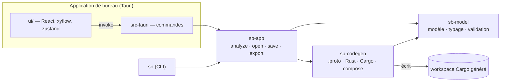
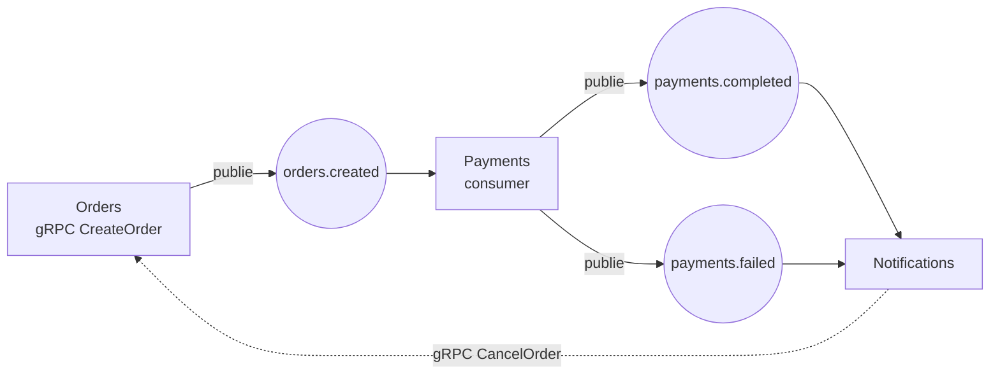

# Architecture

## Vue d'ensemble

| Crate / dossier | Rôle |
| --- | --- |
| `crates/sb-model` | Le document : `Project`, `Service`, `Topic`, `Message`, `Step`… (JSON camelCase), règles de nommage, typage léger des mappings, validation avec diagnostics. Aucune dépendance à Tauri ni au générateur. |
| `crates/sb-codegen` | Du modèle vers un workspace Cargo : `.proto`, crate `contracts`, crate `runtime` embarquée, un crate par service, `docker-compose.yml`. Pur et déterministe. |
| `crates/sb-app` | Services applicatifs partagés par l'app et le CLI `sb` : `analyze` (validation + génération + rustfmt), ouvrir/sauver, exporter. |
| `src-tauri` | Fine couche de commandes Tauri au-dessus de `sb-app`. |
| `ui/` | L'éditeur. Tout ce qui est « intelligent » (validation, génération) est appelé côté Rust. |

## Le modèle de projet

Un projet est un fichier JSON (`schemaVersion`, `messages`, `topics`, `services`). C'est la seule source de
vérité : le canvas, l'inspecteur et le code généré en sont des vues.

- **Messages** : messages protobuf, utilisés à la fois comme charge utile Kafka et comme requête/réponse gRPC.
  Chaque champ a un **numéro stable** (`tag`) : une fois des événements écrits dans Kafka, renuméroter casserait
  les consumers. L'éditeur attribue un numéro à la création et ne le réutilise pas tant que le champ existe ;
  le générateur numérote les champs sans `tag` dans l'ordre.
- **Topics** : un topic transporte exactement un type de message ; un champ clé optionnel donne la clé de partition
  (l'ordre est garanti par clé).
- **Services** : des RPC (gRPC) et des consumers (Kafka). Chacun contient une **liste d'étapes**.
- **Étapes** : `log`, `let`, `publish`, `callRpc`, `branch` (étapes imbriquées), `respond`, `code`.
  Une liste d'étapes est un arbre (pas un graphe arbitraire) : cela se génère en Rust structuré et s'édite comme
  une pile de blocs, comme dans un page builder.

### Noms

Les noms saisis deviennent des identifiants Rust, protobuf et Kafka. On n'accepte que les noms dont la
conversion est sans perte (`order_id` reste `order_id`, `HTTPServer` est refusé car prost le transformerait en
`HttpServer`). Ainsi `input.order_id` dans l'éditeur est exactement `input.order_id` dans le Rust généré.

### Expressions et typage

Une valeur est un **champ** (`input.customer.name`), un **littéral**, ou du **Rust brut**. Les deux premiers sont
typés (`sb-model/src/typing.rs`) : un chemin se résout champ par champ, et il peut remplir un champ cible s'il a le
même type, ou s'il s'élargit en `optional`. Les messages étant des `Option<Msg>` en prost, lire à travers un message
absent donne la valeur par défaut (`.as_ref().map(..).unwrap_or_default()`).

Le Rust brut n'est pas typé : c'est l'échappatoire. Sa syntaxe est tout de même vérifiée avec `syn`, avec le chemin
exact de l'étape fautive.

`ui/src/scope.ts` reprend ces règles pour **proposer** les champs compatibles ; le validateur Rust reste l'autorité
et un test (`scope.test.ts`) fixe la parité sur les cas importants.

### Diagnostics

Chaque diagnostic porte un `code` stable (`E_UNKNOWN_TOPIC`…), un message et un **JSON pointer** vers l'élément
(`/services/0/rpcs/1/steps/2/then/0`). L'UI s'en sert pour afficher le badge sur le bon nœud ou la bonne étape.

## Le code généré

- **Contrats** : un seul `.proto` (package = nom du projet). `protox` le compile en Rust pur, donc **pas de `protoc`**
  à installer. Les noms de topics deviennent des constantes (`topics::ORDERS_CREATED`).
- **Runtime** (`crates/sb-codegen/templates/runtime`) : écrit tel quel dans chaque export. Il contient tout ce qui
  n'a pas à varier : producer idempotent, création des topics au démarrage (avec attente du broker),
  `consume()` at-least-once avec 3 essais puis DLQ.
- **Un service = un binaire** : `main.rs` (câblage), `ctx.rs` (producer + clients gRPC des services appelés),
  `server.rs` (trait tonic qui délègue), `flows.rs` (la logique dessinée : une fonction par RPC ou consumer).
- Les adresses se règlent par variables d'environnement : `KAFKA_BROKERS`, `<SERVICE>_PORT`, `<SERVICE>_URL`.

### Pourquoi générer plutôt qu'interpréter ?

Le résultat est du **Rust ordinaire** : lisible, versionnable, débogable, sans runtime propriétaire ni verrou
fournisseur. L'inconvénient assumé : le code exporté est un artefact. L'export écrase les fichiers, la logique
sur mesure vit dans les étapes *Code Rust* du projet.

### Les compromis qu'on a dû faire

- **`rdkafka` avec la feature `curl`.** librdkafka 2.12 inclut `<curl/curl.h>` même quand curl est désactivé
  (`#define WITH_OAUTHBEARER_OIDC 0` testé avec `#ifdef`). Sans cette feature, la compilation échoue sur toute machine
  sans `libcurl-dev`. Le workspace généré l'active (et le documente) ; à retirer quand l'amont sera corrigé.
- **Formatage.** Le générateur écrit lui-même un Rust commenté et valide (vérifié avec `syn`), puis `sb-app` passe
  `rustfmt` en parallèle si disponible. On n'utilise pas `prettyplease` : il supprime les commentaires.
- **DLQ.** Un message empoisonné est mis de côté, et si l'écriture sur la DLQ échoue elle est retentée sans fin
  (cela bloque la partition) : on ne perd jamais un message en silence.

## L'application

- **Canvas** : le graphe xyflow est *calculé* à partir du projet. Les positions sont stockées dans le projet (on
  sauve au lâcher du nœud) ; les tailles mesurées par xyflow sont conservées d'un calcul au suivant, sinon la minimap
  et le `fitView` les perdent.
- **État** : un store zustand + immer. Les composants éditent le projet avec `edit(draft => …)` ; les renommages
  (message, topic, service, RPC, champ) sont des fonctions de cascade dans `ui/src/model.ts`.
- **Boucle d'analyse** : après chaque modification (anti-rebond 250 ms), l'UI appelle `analyze(project)`. La réponse
  contient les diagnostics et, si le projet est valide, les fichiers générés. Les réponses arrivées dans le
  désordre sont ignorées. Quand le projet est invalide, la dernière version valide du code reste affichée,
  marquée comme périmée.
- **Glisser-déposer** : HTML5 natif depuis la palette. Vérifié dans WebKitGTK (la vraie fenêtre Tauri).

## Feuille de route (idées, par ordre d'intérêt)

1. **Exécuter pour de bon** : bouton « Lancer » (compose + `cargo run` des services) avec logs, et un test d'intégration
   du code généré contre un broker.
2. Tracer les flèches à la souris (service → topic crée une étape *Publier*, topic → service un consumer).
3. Annuler / rétablir (le modèle est un arbre immuable via immer : les patches sont à portée de main).
4. Modèles prêts à l'emploi : saga avec compensation, outbox, CQRS, retry avec backoff.
5. Évolution de schéma : détecter les changements incompatibles par rapport à une version publiée.
6. Autres cibles de sérialisation (Avro/JSON + schema registry), persistance (SQL), observabilité (OpenTelemetry).
7. Internationalisation de l'interface.
